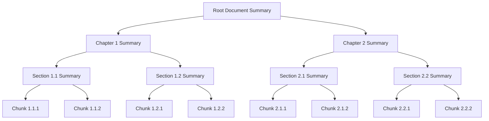
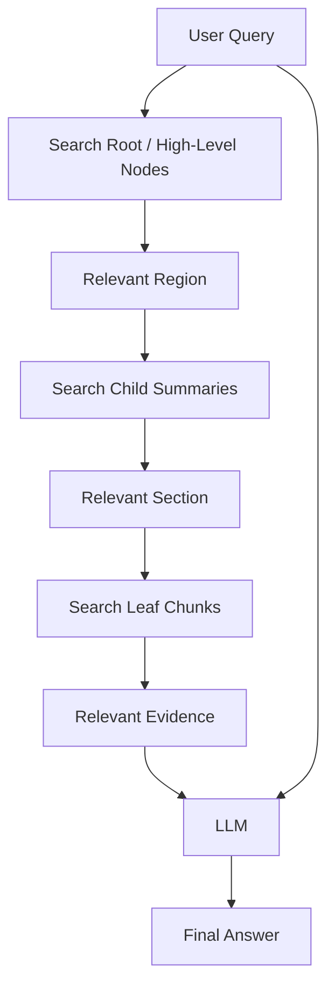
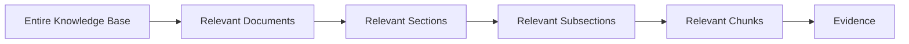
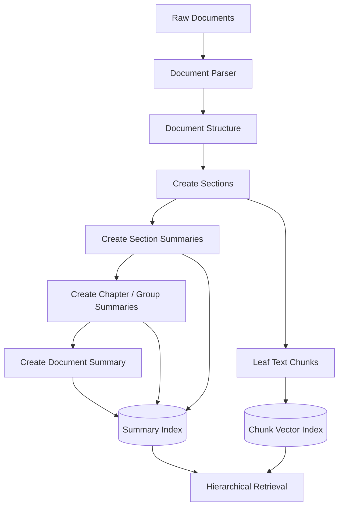
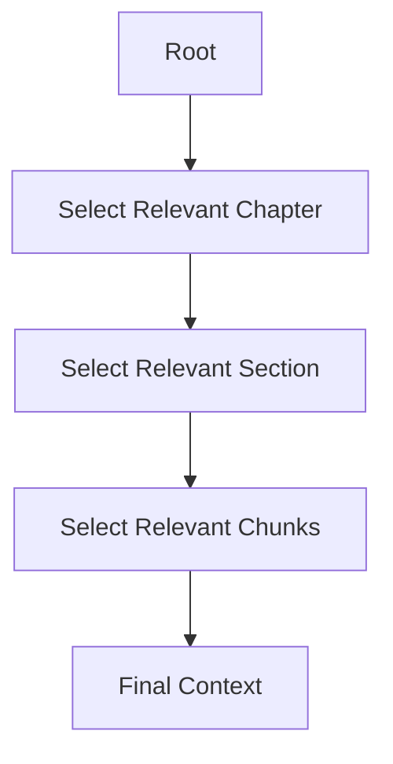
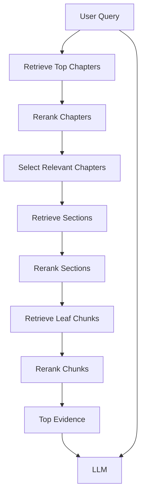
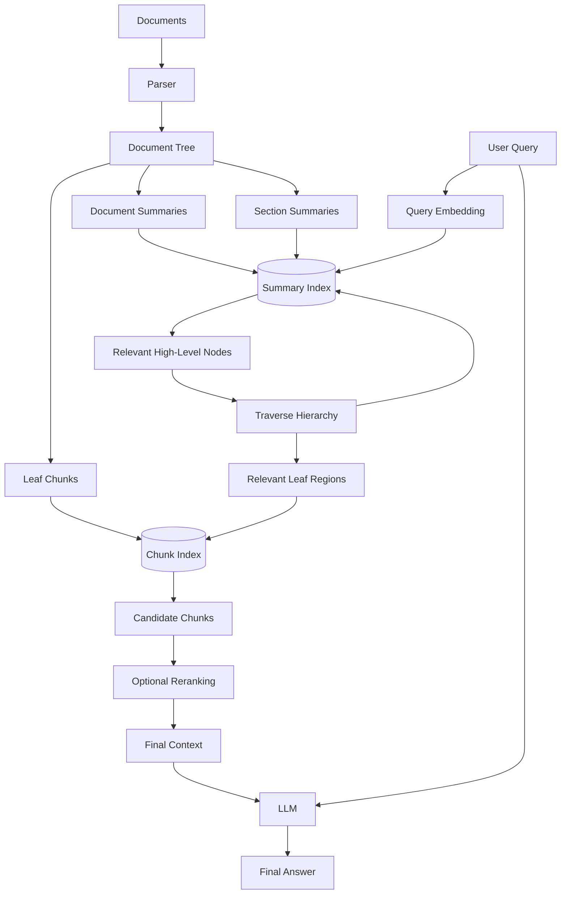
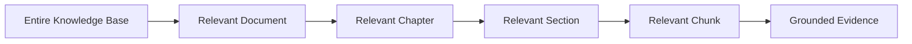

# 10 — Hierarchical RAG

## 📌 Overview

**Hierarchical RAG** organizes a knowledge base into multiple levels of abstraction.

Instead of searching every text chunk independently, the system creates a hierarchy such as:

```text
Document
   ↓
Section
   ↓
Subsection
   ↓
Chunk
```

Higher levels contain **summaries or representations of larger regions**, while lower levels contain increasingly specific information.

Retrieval can begin at a high-level node and progressively traverse toward the most relevant leaf nodes.

### Core idea

> **Search broadly at the top → identify the relevant region → search more precisely at lower levels → retrieve detailed evidence**

This is particularly useful for large documents where searching every chunk at once is expensive or noisy.

---

# 🏗️ Hierarchical Document Structure

A simple hierarchy might look like:



The exact number of levels is not fixed.

A smaller system might use:

```text
Document → Section → Chunk
```

while a large knowledge base might use:

```text
Document
   ↓
Chapter
   ↓
Section
   ↓
Subsection
   ↓
Paragraph
   ↓
Chunk
```

---

# 🌳 Tree Search Navigation

The basic retrieval concept is:



Instead of asking:

> "Which of these 100,000 chunks is relevant?"

the system can progressively ask:

```text
Which document?
      ↓
Which chapter?
      ↓
Which section?
      ↓
Which chunks?
```

---

# 📚 Example

Imagine a 500-page technical book:

```text
Book
├── Chapter 1 — Introduction
├── Chapter 2 — Networking
├── Chapter 3 — Databases
├── Chapter 4 — Authentication
├── Chapter 5 — Deployment
└── Chapter 6 — Security
```

The user asks:

> **"How does the system refresh an expired authentication token?"**

A flat vector search might search thousands of chunks.

Hierarchical RAG can navigate:

```text
Root Summary
      ↓
Authentication Chapter
      ↓
Token Management Section
      ↓
Token Refresh Chunks
```

The search space becomes progressively smaller.

---

# 🔄 Hierarchical Retrieval Flow

## Step 1 — User Query

```text id="hrag03"
How does the system refresh an expired authentication token?
```

---

## Step 2 — Search High-Level Nodes

The system compares the query against high-level summaries.

For example:

```text id="hrag04"
Chapter 1 → Introduction
Chapter 2 → Networking
Chapter 3 → Databases
Chapter 4 → Authentication
Chapter 5 → Deployment
Chapter 6 → Security
```

The authentication summary has the strongest relevance.

```text id="hrag05"
Selected:
Chapter 4 — Authentication
```

---

## Step 3 — Traverse to Lower Level

Now the system searches within Chapter 4.

```text id="hrag06"
Authentication
├── Login
├── Sessions
├── Access Tokens
├── Refresh Tokens
└── Authorization
```

It selects:

```text id="hrag07"
Refresh Tokens
```

---

## Step 4 — Retrieve Leaf Chunks

The system now searches the actual text chunks belonging to that section.

```text id="hrag08"
Refresh Tokens
├── Chunk 4.3.1
├── Chunk 4.3.2
├── Chunk 4.3.3
└── Chunk 4.3.4
```

The most relevant chunks are returned.

---

# 🧭 Coarse-to-Fine Retrieval

Hierarchical RAG follows a **coarse-to-fine** strategy.



Each level reduces the search space.

Think of it like navigating a map:

```text
Country
  ↓
State
  ↓
City
  ↓
Neighborhood
  ↓
Street
```

You don't need to inspect every street in the entire country to find a particular location.

---

# 🧩 How Are Hierarchical Nodes Created?

During ingestion, the system can create summaries for larger sections.

For example:

```text id="hrag10"
Raw Document
     ↓
Split into Sections
     ↓
Generate Section Summaries
     ↓
Group Sections into Chapters
     ↓
Generate Chapter Summaries
     ↓
Generate Document Summary
```

A possible hierarchy:

```text
Document Summary
       │
       ├── Chapter Summary
       │      ├── Section Summary
       │      │      ├── Chunk
       │      │      └── Chunk
       │      │
       │      └── Section Summary
       │             ├── Chunk
       │             └── Chunk
       │
       └── Chapter Summary
              └── ...
```

---

# 🏗️ Indexing Architecture



There are multiple implementation strategies.

You can maintain:

* separate indexes for different hierarchy levels
* one index containing all nodes with level metadata
* a graph/tree structure connecting nodes
* vector indexes combined with a document store

The important part is the **relationship between nodes**.

---

# 🔗 Parent-Child Relationships

Each node can maintain references to its parent and children.

Example:

```json id="hrag12"
{
  "id": "section_4_3",
  "type": "section",
  "parentId": "chapter_4",
  "childIds": [
    "chunk_4_3_1",
    "chunk_4_3_2",
    "chunk_4_3_3"
  ]
}
```

This allows the retriever to navigate:

```text
Parent
  ↓
Children
  ↓
Grandchildren
```

---

# 🔎 Two Common Retrieval Strategies

Hierarchical RAG does not have only one retrieval algorithm.

## Strategy 1 — Top-Down Traversal

Start at the root and progressively descend.



This is the simplest mental model for Hierarchical RAG.

---

## Strategy 2 — Retrieve at Multiple Levels

The system can retrieve relevant nodes from several levels.

For example:

```text id="hrag14"
Query
 ↓
Top relevant chapter
 ↓
Top relevant sections
 ↓
Top relevant chunks
```

The final context may contain both:

* high-level summaries
* detailed evidence

This can help the LLM understand both **where the information comes from** and **what the actual evidence says**.

---

# 🧠 Summary Nodes vs Raw Chunks

Higher-level nodes usually contain summaries.

For example:

### Chapter Summary

```text id="hrag15"
This chapter explains authentication architecture,
including login, sessions, access tokens, refresh tokens,
and authorization.
```

### Leaf Chunk

```text id="hrag16"
When an access token expires, the client sends the refresh
token to the authentication endpoint. The server validates
the refresh token and issues a new access token...
```

The summary helps with **navigation**.

The chunk provides **specific evidence**.

This creates a useful distinction:

```text
Summary
   ↓
Navigation / Routing

Chunk
   ↓
Evidence / Grounding
```

---

# ⚡ Why Hierarchical RAG?

Consider a knowledge base containing:

```text id="hrag17"
10,000 documents
500,000 chunks
```

A flat retrieval architecture might search the entire chunk index.

Hierarchical retrieval can first identify:

```text id="hrag18"
10,000 documents
      ↓
20 relevant documents
      ↓
Relevant sections
      ↓
Relevant chunks
```

This can reduce irrelevant candidates and potentially reduce retrieval work.

However, **hierarchical traversal is not automatically faster**. The number of levels, branching factor, index implementation, and retrieval strategy all affect latency and cost.

---

# 📊 Hierarchical RAG vs Parent-Document RAG

These architectures are closely related but have different goals.

| Feature                | Parent-Document RAG            | Hierarchical RAG           |
| ---------------------- | ------------------------------ | -------------------------- |
| Structure              | Usually parent → child         | Multiple levels            |
| Retrieval              | Child → parent                 | Top-down / multi-level     |
| Main goal              | Better context                 | Structured navigation      |
| Hierarchy depth        | Usually shallow                | Potentially deep           |
| Higher-level summaries | Optional                       | Common                     |
| Search strategy        | Usually direct child retrieval | Progressive retrieval      |
| Best for               | Context expansion              | Large structured knowledge |
| Complexity             | Moderate                       | Higher                     |

### Parent-Document

```text
Child
  ↓
Parent
```

### Hierarchical RAG

```text
Document
   ↓
Chapter
   ↓
Section
   ↓
Subsection
   ↓
Chunk
```

The distinction is important.

> **Parent-Document RAG primarily solves the retrieval-context granularity problem. Hierarchical RAG primarily solves the navigation and organization problem across multiple levels.**

---

# 🔥 Hierarchical RAG + Reranking

Reranking can be applied at different levels.

For example:



This can improve precision at each navigation stage, but repeatedly reranking at multiple levels also increases cost and latency.

---

# 🔥 Hierarchical RAG + Parent-Document RAG

The two techniques can work together.

For example:

```text id="hrag20"
Document
   ↓
Chapter
   ↓
Section
   ↓
Child Chunk
```

The system uses hierarchical navigation to find:

```text
Section 4.3
```

Then uses the section as the larger context around the matching child chunks.

So:

```text
Hierarchical RAG
      ↓
Find relevant region
      ↓
Parent-Document retrieval
      ↓
Expand context
      ↓
LLM
```

---

# ⚠️ Important Challenges

## 1. Summary Quality

If a high-level summary misses an important concept, the retriever may never navigate into that region.

```text
Bad Summary
     ↓
Region appears irrelevant
     ↓
Region skipped
     ↓
Relevant chunk never retrieved
```

This is sometimes called a **routing failure**.

---

## 2. Error Propagation

A top-level mistake can propagate downward.

```text
Root
 ↓
Wrong Chapter
 ↓
Wrong Section
 ↓
Wrong Chunks
```

Therefore, overly strict top-down traversal can hurt recall.

One way to reduce this risk is to keep multiple candidates at each level rather than selecting only one node.

For example:

```text
Top 3 Chapters
     ↓
Top 5 Sections per Chapter
     ↓
Top 10 Chunks
```

---

## 3. More Complex Ingestion

Compared with basic RAG, you may need to create and maintain:

* summaries
* hierarchy IDs
* parent-child relationships
* multiple indexes
* node metadata

This increases implementation complexity.

---

## 4. More Retrieval Steps

A flat RAG pipeline might do:

```text
Query → Search → Chunks
```

Hierarchical RAG might do:

```text
Query
 ↓
Root Search
 ↓
Chapter Search
 ↓
Section Search
 ↓
Chunk Search
```

More stages can increase latency.

---

# 🏭 Production-Oriented Architecture

A practical system might look like:



---

# 🎯 When Should You Use Hierarchical RAG?

Hierarchical RAG is especially useful for:

* very large documents
* books
* research reports
* technical documentation
* legal collections
* enterprise knowledge bases
* structured documentation
* large manuals
* datasets with natural document hierarchy

For a small collection of simple documents, standard vector or hybrid RAG may be simpler and sufficient.

---

# 🧪 Example: Technical Documentation

Imagine an API documentation system:

```text
API Documentation
│
├── Authentication
│   ├── API Keys
│   ├── OAuth
│   └── JWT
│
├── Users
│   ├── Create User
│   ├── Update User
│   └── Delete User
│
└── Payments
    ├── Create Payment
    ├── Refund
    └── Webhooks
```

User asks:

> "How do I refresh an expired JWT?"

Hierarchical retrieval can navigate:

```text
API Documentation
       ↓
Authentication
       ↓
JWT
       ↓
Token Refresh
       ↓
Relevant Chunks
```

Rather than treating the entire documentation set as one flat pool.

---

# ⚖️ Tradeoffs

### Advantages

* Works well with large document collections
* Exploits document structure
* Supports coarse-to-fine retrieval
* Can reduce irrelevant search space
* Provides useful high-level navigation
* Can combine summaries with detailed evidence
* Works well with structured documents

### Disadvantages

* More complicated ingestion
* Requires maintaining hierarchy relationships
* Additional retrieval stages can increase latency
* Summary generation adds processing cost
* Poor summaries can cause routing failures
* Strict top-down traversal can reduce recall
* More difficult to tune than basic RAG

---

# 🧠 Key Mental Model

Think of Hierarchical RAG as **zooming into a document**.



Instead of searching everything at the same level:

```text
❌ Flat:

500,000 chunks
     ↓
Search everything
```

Hierarchical RAG attempts:

```text
✅ Hierarchical:

Knowledge Base
     ↓
Relevant Region
     ↓
Relevant Section
     ↓
Relevant Chunk
```

The central idea is:

> **Use broad representations to navigate and detailed representations to retrieve evidence.**

---

# 📌 Key Takeaway

**Hierarchical RAG = Multi-Level Document Organization + Coarse-to-Fine Retrieval**

The core pipeline is:

```text id="hrag23"
Documents
    ↓
Build Hierarchy
    ↓
Document Summary
    ↓
Chapter / Section Summaries
    ↓
Leaf Chunks
    ↓
User Query
    ↓
High-Level Retrieval
    ↓
Navigate Relevant Nodes
    ↓
Retrieve Leaf Chunks
    ↓
Optional Reranking
    ↓
Grounded Context
    ↓
LLM
    ↓
Final Answer
```

### Remember

> 🔹 **Basic RAG** → retrieve chunks directly
> 🔹 **Parent-Document RAG** → retrieve a small child, provide its larger parent
> 🔹 **Hierarchical RAG** → navigate through multiple levels to reach relevant evidence
> 🔹 **Multi-Query RAG** → search from multiple query perspectives
> 🔹 **HyDE** → create a hypothetical document to improve retrieval representation
> 🔹 **Reranking** → improve the ordering of retrieved candidates

**Core principle:**

> **Hierarchical RAG treats retrieval as navigation through a document tree: start broad, progressively narrow the search, and finish with the specific evidence needed by the LLM.**
