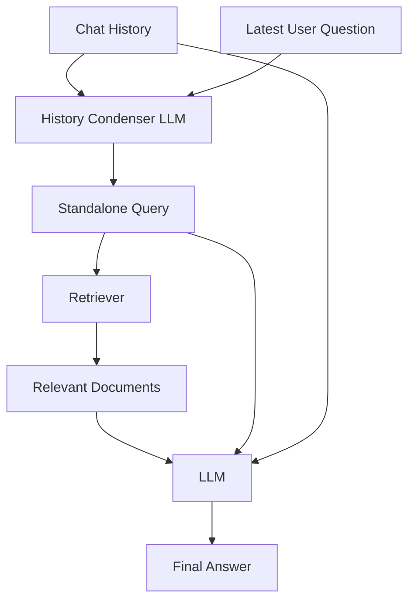
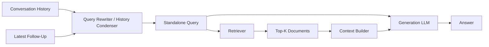
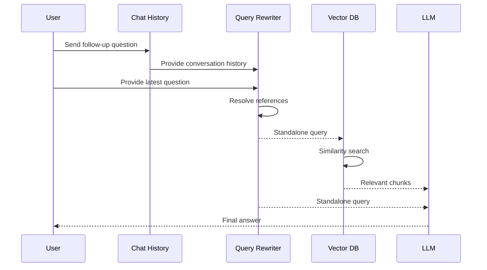
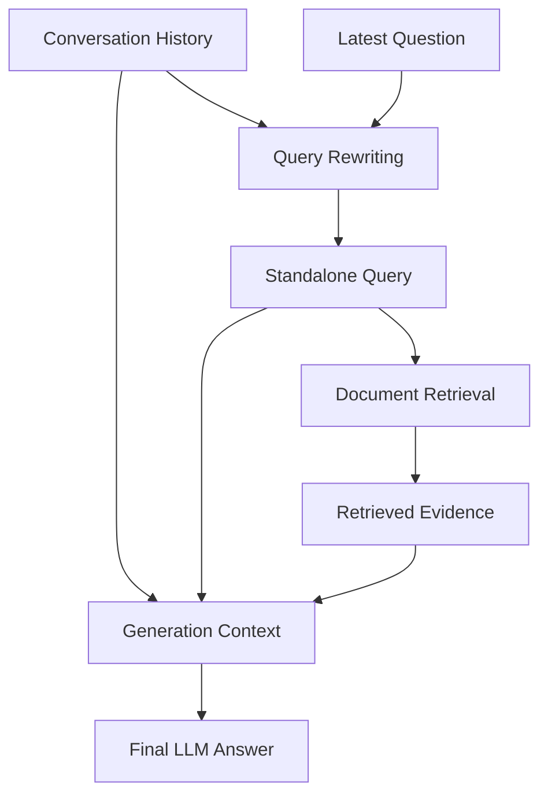
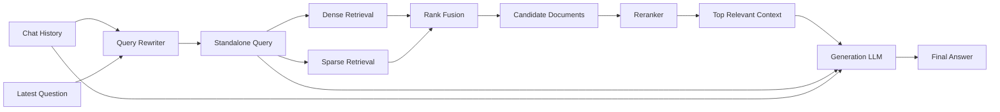
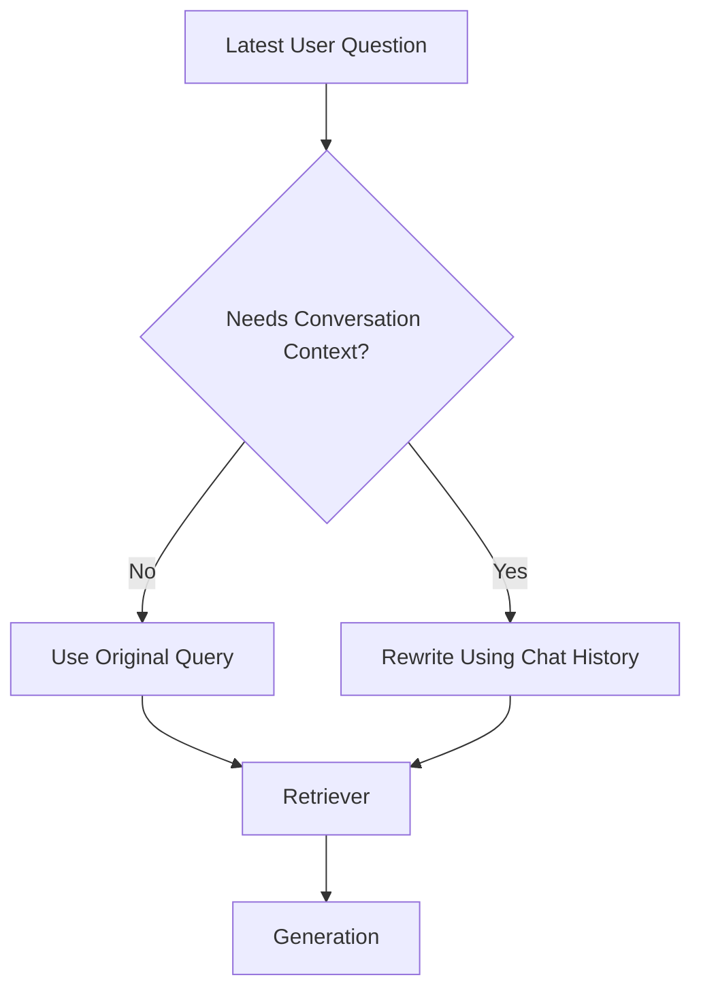
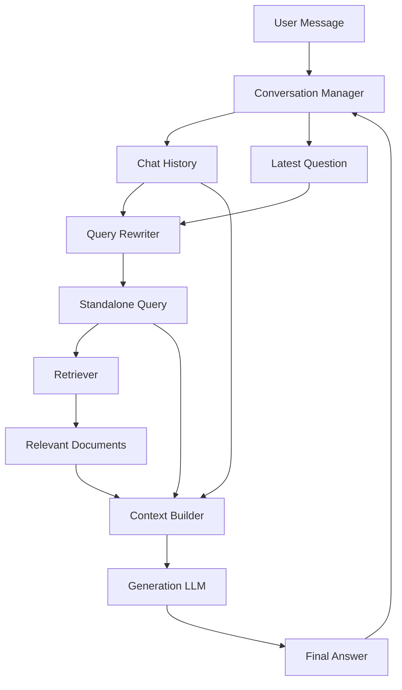
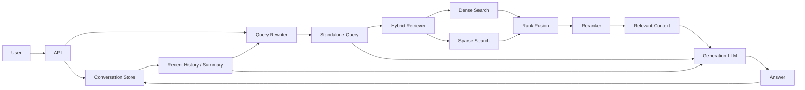

# 12 — Conversational RAG

## 📌 Overview

**Conversational RAG** extends traditional RAG to support **multi-turn conversations**.

In normal RAG, a user question is usually treated as an independent query:

> "What is the pricing?"

The problem is that the question may depend on earlier conversation:

> **User:** Tell me about Product X.
> **Assistant:** Product X is an AI productivity platform...
> **User:** What about its pricing?

The latest question, **"What about its pricing?"**, is incomplete by itself.

Conversational RAG solves this by using the **conversation history** to transform the follow-up question into a **standalone, self-contained query** before retrieval.



The core idea is:

> **Conversation History + Follow-Up Question → Standalone Query → Retrieval → Generation**

---

## 🎯 Why Conversational RAG Is Needed

Traditional RAG works well when questions are self-contained.

For example:

```text
User:
What is the refund policy?

Retriever:
Searches for "refund policy"
```

But real conversations often contain references to previous messages:

```text
User:
Tell me about Product X.

Assistant:
Product X is an AI-powered analytics platform.

User:
How much does it cost?

Assistant:
...
```

The second question:

```text
"How much does it cost?"
```

doesn't explicitly mention **Product X**.

A vector search system may retrieve unrelated documents about pricing because it doesn't know what **"it"** refers to.

Conversational RAG adds a query-rewriting step.

---

# 🏗️ Conversational RAG Architecture



There are two major stages:

### Stage 1 — Query Rewriting

Convert:

```text
"What about its pricing?"
```

into:

```text
"What is the pricing model for Product X?"
```

### Stage 2 — Normal RAG

The rewritten query is then passed through the normal retrieval pipeline:

```text
Standalone Query
      ↓
Retriever
      ↓
Relevant Chunks
      ↓
Context
      ↓
LLM
      ↓
Answer
```

---

# 🔄 Conversation Flow

Consider this conversation:

```text
User:
What is Product X?

Assistant:
Product X is an AI-powered analytics platform.

User:
What features does it have?

Assistant:
It provides analytics, dashboards, and automated reports.

User:
What about its pricing?
```

The final question is ambiguous without history.

The query rewriter receives:

```text
Chat History:
- What is Product X?
- What features does it have?
- Product X provides analytics, dashboards, and reports.

Latest Question:
"What about its pricing?"
```

It generates:

```text
"What is the pricing model for Product X?"
```

That standalone query is then used for retrieval.

---

# 🧠 History Condenser

The **history condenser** is typically an LLM prompt responsible for rewriting the latest user message.

Its job is **not to answer the question**.

Its job is to transform the question into a form that can be understood independently.

### Input

```text
Chat History:
User: What is Product X?
Assistant: Product X is an AI analytics platform.

User:
What about its pricing?
```

### Output

```text
What is the pricing model for Product X?
```

---

# 📝 Query Rewriting Prompt

A simple implementation can use a prompt like:

```text
Given the conversation history and the latest user question,
rewrite the latest question into a standalone question.

Rules:
- Preserve the user's original intent.
- Resolve references such as "it", "they", "that", and "this".
- Include important entities from the conversation.
- Do not answer the question.
- Return only the standalone question.

Conversation:
{chat_history}

Latest question:
{question}
```

Example:

```text
History:
User: Tell me about React Native.
Assistant: React Native is a framework for building mobile applications.

Question:
"What about its performance?"
```

Rewritten query:

```text
"How does React Native perform compared with other mobile development frameworks?"
```

---

# 🔎 Retrieval After Rewriting

Once the standalone query is generated, it goes through the normal retrieval pipeline.



---

# 🧩 Context Has Two Different Roles

One important concept in Conversational RAG is that **conversation history and retrieved documents serve different purposes**.

### Conversation History

Provides:

* Previous questions
* Previous answers
* References
* User intent
* Conversation state

### Retrieved Context

Provides:

* Grounding information
* Facts from the knowledge base
* Supporting evidence

Conceptually:



This distinction is important because **chat history is not necessarily authoritative knowledge**.

The knowledge base should generally remain the source of truth for factual answers.

---

# 🔁 Multi-Turn Example

### Turn 1

```text
User:
What is PostgreSQL?
```

Standalone query:

```text
What is PostgreSQL?
```

---

### Turn 2

```text
User:
Who created it?
```

The question depends on the previous turn.

Rewritten query:

```text
Who created PostgreSQL?
```

---

### Turn 3

```text
User:
When was it released?
```

Rewritten query:

```text
When was PostgreSQL first released?
```

---

### Turn 4

```text
User:
Is it still actively maintained?
```

Rewritten query:

```text
Is PostgreSQL still actively maintained?
```

Each query becomes independently searchable.

---

# ⚖️ Conversational RAG vs Normal RAG

| Feature                 | Normal RAG     | Conversational RAG |
| ----------------------- | -------------- | ------------------ |
| Single question         | ✅              | ✅                  |
| Multi-turn conversation | Limited        | ✅                  |
| Follow-up questions     | ❌ / unreliable | ✅                  |
| Uses chat history       | Usually no     | ✅                  |
| Query rewriting         | Optional       | Core component     |
| Context awareness       | Low            | High               |
| Retrieval complexity    | Lower          | Higher             |
| LLM calls               | Usually fewer  | Usually more       |

---

# 🔀 Conversational RAG vs Multi-Query RAG

These architectures may look similar because both can generate new queries, but their purposes are different.

### Multi-Query RAG

Creates **multiple independent search perspectives**.

```text
Question
   ↓
Query 1 ──┐
Query 2 ──┼──→ Retrieval
Query 3 ──┘
```

Goal:

> **Increase retrieval recall through query diversity.**

### Conversational RAG

Creates **one standalone query from conversation context**.

```text
Chat History
      +
Follow-Up Question
      ↓
Standalone Query
      ↓
Retrieval
```

Goal:

> **Resolve conversational references and preserve user intent.**

### Core Difference

> **Multi-Query = multiple retrieval perspectives.**
> **Conversational RAG = conversational context resolution.**

They can also be combined.

---

# 🔥 Conversational RAG + Hybrid Retrieval

Conversational RAG does not require vector search specifically.

The rewritten query can be sent to:

```text
Standalone Query
      ↓
 ┌────┴─────┐
 ↓          ↓
Dense      BM25
Search     Search
 ↓          ↓
 └────┬─────┘
      ↓
     RRF
      ↓
Reranking
      ↓
Context
      ↓
LLM
```

This creates a powerful architecture:

**Conversation-aware + semantic + lexical retrieval.**

---

# 🚀 Conversational RAG + Reranking

A production-oriented pipeline can look like:



This combines several RAG techniques learned so far:

```text
Conversational RAG
       ↓
Query Rewriting
       ↓
Hybrid Retrieval
       ↓
RRF
       ↓
Reranking
       ↓
Generation
```

---

# 🧠 Conversation Memory

A conversational system must decide **how much history to keep**.

A conversation might contain:

```text
Turn 1
Turn 2
Turn 3
...
Turn 50
Turn 51
```

Sending the entire conversation to the LLM every time can increase:

* Token usage
* Latency
* Context size
* Noise

A system can instead use strategies such as:

### Recent Turns

Keep only the latest N messages.

```text
Turn 47
Turn 48
Turn 49
Turn 50
Turn 51
```

### Summarized History

Compress older conversation:

```text
Earlier conversation summary:
User is building a RAG application using Node.js
and wants to compare retrieval architectures.
```

Then retain recent messages separately.

### Structured Memory

Store important long-term information separately:

```text
User Preferences
Conversation Facts
Tasks
Entities
Previous Decisions
```

This connects Conversational RAG with **Memory RAG**, which will be useful later in the learning path.

---

# ⚠️ Query Rewriting Is Not Always Necessary

Not every question needs rewriting.

For example:

```text
User:
What is BM25?
```

This is already self-contained.

Rewriting it might produce:

```text
What is BM25?
```

There is little benefit.

A production system can therefore decide whether the question actually depends on history.



This can reduce unnecessary LLM calls.

---

# ⚠️ Common Problems

## 1. Incorrect Reference Resolution

User:

```text
Tell me about Product A.

What about its competitors?
```

The rewriter might incorrectly associate **"its"** with another entity mentioned earlier.

---

## 2. Query Drift

The rewritten query may accidentally change the user's intent.

Original:

```text
How much does Product X cost?
```

Bad rewrite:

```text
What are the advantages and pricing plans of Product X?
```

The rewritten query has introduced information the user didn't request.

A good rewriter should **preserve intent**, not expand the question unnecessarily.

---

## 3. Long Conversation History

Large conversations can increase:

```text
Tokens
  ↓
Cost
  ↓
Latency
```

History summarization or selective memory can help.

---

## 4. Ambiguous Conversations

Sometimes even humans cannot determine what:

```text
"What about that one?"
```

refers to.

The system may need to ask a clarification question instead of guessing.

---

# 🛡️ Important Production Consideration

The query rewriter should not be treated as an authoritative source of facts.

For example:

```text
Conversation:
Product X costs $20/month.

User:
What about its pricing?
```

The rewriter may produce:

```text
What is the pricing of Product X?
```

But the generated query itself does **not** prove that Product X costs $20/month.

The system should retrieve authoritative documents and use those documents for factual grounding.

---

# 📊 Conversational RAG Pipeline

The complete architecture can be summarized as:



---

# 🏭 Production-Oriented Architecture

A more complete production system might look like:



Possible components include:

```text
Conversation Store
        ↓
History Management
        ↓
Query Rewriting
        ↓
Hybrid Retrieval
        ↓
Reranking
        ↓
Context Construction
        ↓
LLM Generation
```

---

# 🔗 How Conversational RAG Connects With Previous Labs

Conversational RAG is not a completely separate retrieval algorithm.

It is primarily a **conversation-aware layer around the retrieval pipeline**.

For example:

```text
Conversational RAG
        ↓
Query Rewriting
        ↓
Multi-Query
        ↓
Hybrid Retrieval
        ↓
Metadata Filtering
        ↓
Reranking
        ↓
Parent Document Retrieval
        ↓
LLM
```

Different techniques solve different problems:

| Technique              | Main Problem It Solves                                        |
| ---------------------- | ------------------------------------------------------------- |
| Vector RAG             | Semantic retrieval                                            |
| Keyword RAG            | Exact lexical retrieval                                       |
| Hybrid RAG             | Semantic + lexical retrieval                                  |
| Metadata Filtering     | Restrict searchable data                                      |
| Reranking              | Improve relevance ordering                                    |
| Multi-Query            | Increase retrieval recall                                     |
| HyDE                   | Improve query representation                                  |
| Parent-Document        | Retrieve granularly, generate with broader context            |
| Hierarchical RAG       | Navigate multi-level document structure                       |
| Multi-Hop RAG          | Retrieve information through dependent steps                  |
| **Conversational RAG** | **Understand follow-up questions using conversation context** |

---

# ⚖️ Tradeoffs

### Advantages

* Supports natural multi-turn conversations
* Resolves references such as *it*, *they*, *that*, and *this*
* Makes follow-up questions searchable
* Works with vector, sparse, hybrid, and other retrieval methods
* Improves user experience for chat-based applications

### Disadvantages

* Requires conversation state management
* Query rewriting introduces additional latency/cost
* Poor rewriting can change user intent
* Long conversations increase context-management complexity
* Ambiguous references can still require clarification
* More moving parts than single-turn RAG

---

# 🧠 Key Mental Model

Remember Conversational RAG as:

```text
Previous Conversation
        +
Latest Follow-Up
        ↓
Query Rewriting
        ↓
Standalone Query
        ↓
Retrieval
        ↓
Relevant Evidence
        ↓
LLM
        ↓
Answer
```

The most important distinction is:

> **The conversation provides context; the knowledge base provides evidence.**

And:

> **Conversational RAG does not fundamentally change how documents are retrieved. It makes the user's latest question retrieval-ready by resolving conversational context.**

---

# 📌 Key Takeaway

**Conversational RAG = RAG + Conversation Awareness**

Instead of treating every user message as an isolated query:

```text
"What about its pricing?"
```

the system uses previous conversation context to create:

```text
"What is the pricing model for Product X?"
```

and then performs normal retrieval.

### Core idea

> **Conversation History + Follow-Up Question → Standalone Query → Retrieval → Grounded Answer**

Once this concept is understood, the next step is **Memory RAG**, where the system goes beyond short-term conversational history and learns how to store, retrieve, and use information across longer periods of interaction.
