# 13 — GraphRAG (Knowledge Graphs + Vector Retrieval)

## 📌 Overview

**GraphRAG** combines **Knowledge Graphs (KGs)** with traditional retrieval techniques such as **dense vector search**.

Instead of representing knowledge only as independent text chunks, GraphRAG explicitly models:

* **Entities** → graph nodes
* **Relationships** → graph edges
* **Properties** → attributes attached to nodes/edges
* **Text chunks** → source evidence connected to graph entities

For example:

```text
ACME Corp
    │
    ├── ACQUIRED ──► Startup X
    │                    │
    │                    └── HAS_PATENT ──► Patent Y
    │
    └── FOUNDED_BY ──► Person Z
```

This allows the system to answer questions that require **relationships between multiple entities**, while vector retrieval remains useful for finding relevant unstructured text.

A common implementation uses **Neo4j** as the graph database and **Cypher** for graph queries.

---

# 🧠 Why GraphRAG?

Traditional vector RAG is excellent at finding **semantically similar text**.

For example:

```text
User:
What does ACME Corp say about its cloud platform?
```

Vector search can retrieve relevant documentation.

But consider:

```text
User:
Which startups acquired by ACME Corp have patents related to AI?
```

This requires connecting several facts:

```text
ACME Corp
    ↓ acquired
Startup
    ↓ has
Patent
    ↓ related to
AI
```

A vector search may retrieve relevant chunks, but it does not inherently understand the explicit relationship:

```text
Company ──ACQUIRED──► Startup ──HAS_PATENT──► Patent
```

A knowledge graph represents that relationship directly.

---

# 🏗️ Knowledge Graph Structure

A Knowledge Graph generally consists of:

```text
Nodes + Edges + Properties
```

Example:

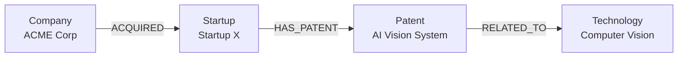

### Nodes

Represent entities such as:

```text
Company
Person
Product
Startup
Patent
Technology
Location
Organization
```

### Edges

Represent relationships:

```text
ACQUIRED
FOUNDED_BY
WORKS_FOR
OWNS
PRODUCES
HAS_PATENT
LOCATED_IN
RELATED_TO
```

### Properties

Store additional information:

```text
Company:
  name = "ACME Corp"
  industry = "Technology"

Startup:
  name = "Startup X"
  founded = 2021
```

---

# 📥 Graph Construction

The graph needs to be constructed from source data.

A typical pipeline looks like:

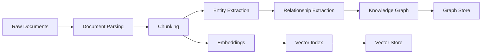

The important idea is that **the same source documents can contribute to both retrieval systems**.

### Graph side

Extract:

```text
Entities
Relationships
Properties
```

### Vector side

Store:

```text
Chunks
Embeddings
Metadata
```

This gives GraphRAG two complementary representations of the same knowledge.

---

# 🔎 Graph Traversal

Suppose the graph contains:

```text
ACME Corp
   ↓ ACQUIRED
Startup X
   ↓ HAS_PATENT
Patent Y
```

We can traverse this relationship using Cypher.

```cypher
MATCH (c:Company {name: "ACME Corp"})
      -[:ACQUIRED]->(s:Startup)
      -[:HAS_PATENT]->(p:Patent)

RETURN c.name, s.name, p.title;
```

Conceptually:

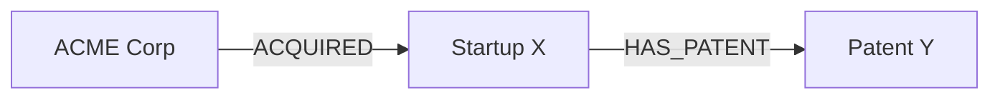

The query explicitly asks Neo4j to follow:

```text
Company
  ↓ ACQUIRED
Startup
  ↓ HAS_PATENT
Patent
```

---

# 🔀 Graph Retrieval + Vector Retrieval

GraphRAG does not necessarily mean **graph instead of vectors**.

A powerful architecture combines both.

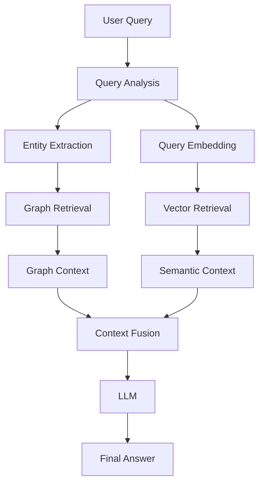

The two retrieval paths answer different questions.

### Graph Retrieval

Good at:

> **How are these entities connected?**

### Vector Retrieval

Good at:

> **Which text passages are semantically relevant?**

Together:

> **What entities are connected, and what does the source material say about them?**

---

# 🔄 Complete GraphRAG Flow

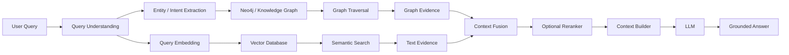

---

# 🧩 Graph Retrieval

Graph retrieval typically starts by identifying entities or concepts in the question.

Example:

```text
User Query:
Which AI patents belong to startups acquired by ACME Corp?
```

The system may identify:

```text
Entity:
ACME Corp

Intent:
Find acquired startups → find their patents → filter AI-related patents
```

Then it can construct a graph query.

```cypher
MATCH (c:Company {name: "ACME Corp"})
      -[:ACQUIRED]->(s:Startup)
      -[:HAS_PATENT]->(p:Patent)

WHERE toLower(p.title) CONTAINS "ai"

RETURN s.name, p.title;
```

The exact query depends on the graph schema.

---

# 📚 Vector Retrieval

At the same time, the query can be embedded and used for semantic retrieval.

For example:

```text
Query:
"AI patents owned by startups acquired by ACME Corp"
```

Vector search may find source passages discussing:

```text
- ACME Corp acquisition of Startup X
- Startup X patent portfolio
- AI research performed by Startup X
- Patent ownership details
```

These passages provide the **textual evidence** behind the graph relationships.

---

# 🧠 Graph Context vs Text Context

This distinction is extremely important.

### Graph Context

Might look like:

```text
ACME Corp
  └── ACQUIRED → Startup X
                    └── HAS_PATENT → Patent Y
```

### Text Context

Might contain:

```text
"ACME Corp acquired Startup X in 2024.
Startup X owns a patent titled AI Vision System..."
```

Graph data gives you **structured relationships**.

Text data gives you **detailed source information**.

GraphRAG can combine both.

---

# 🔗 Multi-Hop Reasoning With Graphs

GraphRAG becomes especially useful when answering **multi-hop questions**.

Consider:

```text
Who acquired the company that created the technology
used in Product X?
```

The reasoning path could be:

```text
Product X
   ↓ USES
Technology A
   ↓ CREATED_BY
Company B
   ↓ ACQUIRED_BY
Company C
```

A graph makes this relationship explicit.

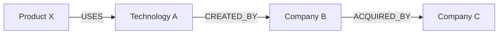

The system can traverse the graph to discover the connected entities.

---

# 🔥 GraphRAG + Multi-Hop RAG

The two techniques complement each other.

**Multi-Hop RAG** describes the retrieval/reasoning pattern:

```text
Hop 1 → Finding A
Hop 2 → Finding B
Hop 3 → Finding C
```

**GraphRAG** provides a structured representation that can make those relationships easier to traverse.

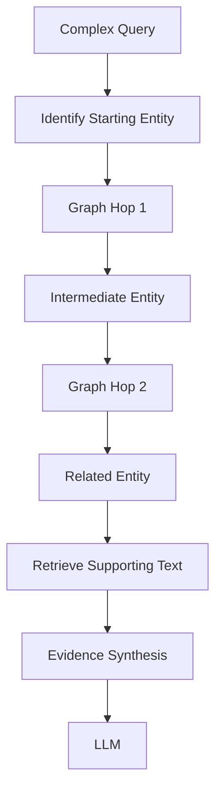

Important:

> **Multi-Hop RAG does not require a knowledge graph.**

It can perform sequential retrieval using vector or keyword search as well.

---

# 🔀 GraphRAG + Hybrid Retrieval

Graph retrieval can also be combined with the hybrid architecture from Lab 04.

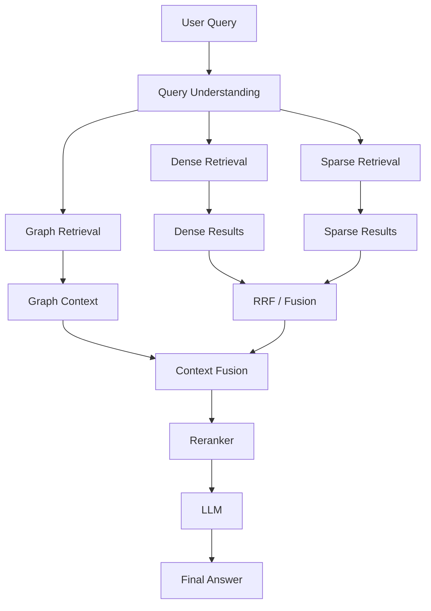

This provides three complementary retrieval signals:

| Retrieval | Best At                  |
| --------- | ------------------------ |
| Graph     | Explicit relationships   |
| Dense     | Semantic similarity      |
| Sparse    | Exact terminology        |
| Reranker  | Final relevance ordering |

---

# 🔎 Graph Traversal vs Vector Search

| Feature                 | Vector Retrieval       | Graph Retrieval                  |
| ----------------------- | ---------------------- | -------------------------------- |
| Semantic similarity     | ✅ Excellent            | ❌ Not its primary purpose        |
| Exact relationships     | Limited                | ✅ Excellent                      |
| Entity connections      | Implicit               | ✅ Explicit                       |
| Unstructured text       | ✅ Excellent            | Requires source text integration |
| Multi-hop relationships | Possible but difficult | ✅ Natural                        |
| Exact names/terms       | Moderate               | ✅ Strong when modeled            |
| Structured reasoning    | Limited                | ✅ Strong                         |
| Schema required         | No                     | Usually yes                      |
| Setup complexity        | Lower                  | Higher                           |

The two approaches are **complementary rather than mutually exclusive**.

---

# 🏭 Production GraphRAG Architecture

A production-oriented architecture might look like:

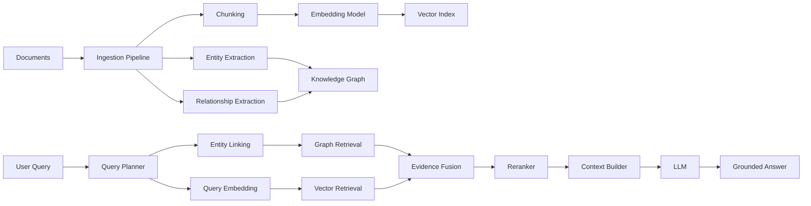

The **query planner** can decide which retrieval methods are useful for the particular question.

For example:

```text
Question A:
"What is RAG?"
        ↓
Vector Retrieval may be enough
```

Whereas:

```text
Question B:
"Which companies acquired startups founded by
former employees of Company X?"
        ↓
Graph Retrieval + Multi-Hop + Text Evidence
```

---

# 🧱 Knowledge Graph Schema Matters

One of the biggest differences from basic vector RAG is that GraphRAG requires a meaningful **graph schema**.

For example:

```text
(:Company)
(:Person)
(:Product)
(:Startup)
(:Patent)
(:Technology)
```

Relationships:

```text
(:Company)-[:ACQUIRED]->(:Startup)

(:Person)-[:FOUNDED]->(:Startup)

(:Startup)-[:HAS_PATENT]->(:Patent)

(:Product)-[:USES]->(:Technology)
```

A poor schema can make graph retrieval difficult even if the underlying data is good.

Therefore:

> **Graph quality directly affects retrieval quality.**

---

# 🧩 Entity Resolution

A practical GraphRAG system must also deal with different names referring to the same entity.

For example:

```text
"OpenAI"
"OpenAI, Inc."
"OpenAI Inc"
```

may represent the same organization.

Similarly:

```text
"Google"
"Google LLC"
"Google Inc."
```

may need to resolve to one canonical entity.

This process is commonly called **entity resolution** or **entity linking**.

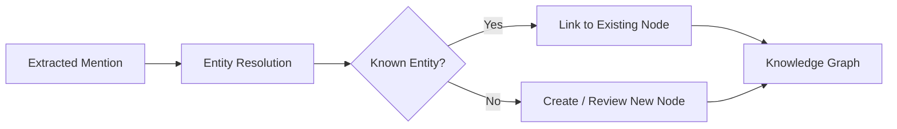

Without good entity resolution, the graph can become fragmented with duplicate nodes.

---

# 📌 Source Grounding

A strong GraphRAG system should maintain links from graph information back to the original source.

For example:

```text
Patent Y
   │
   ├── title
   ├── owner
   ├── related technology
   └── source_chunk_id
```

This makes it possible to retrieve the original text supporting a graph relationship.

Conceptually:

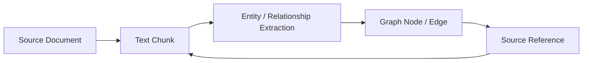

This is important for:

* citations
* debugging
* provenance
* trust
* updating the graph
* validating extracted relationships

---

# ⚠️ Common Challenges

## 1. Graph Construction Cost

Building a knowledge graph can require:

```text
Entity Extraction
        +
Relationship Extraction
        +
Entity Resolution
        +
Schema Design
```

This can be significantly more complex than simply creating embeddings.

---

## 2. Extraction Errors

If the LLM incorrectly extracts:

```text
Company A ──ACQUIRED──► Company B
```

when the source actually says the opposite, the graph contains incorrect structured knowledge.

---

## 3. Graph Maintenance

Documents change.

Therefore the graph may need:

```text
Updates
Deletions
Entity merging
Relationship updates
Re-indexing
```

---

## 4. Schema Design

An overly simple schema may not represent enough relationships.

An overly complex schema can make querying and maintenance difficult.

---

## 5. Graph Traversal Explosion

A query that starts from one entity can potentially traverse many connected nodes.

For example:

```text
Company
 ↓
Employees
 ↓
Companies
 ↓
Products
 ↓
Technologies
 ↓
Patents
```

Unrestricted traversal can generate too much context.

Production systems therefore often use:

* hop limits
* relationship filters
* entity filters
* scoring
* query planning
* result limits

---

# 🧠 GraphRAG vs Traditional RAG

The simplest mental comparison is:

### Traditional RAG

```text
Question
   ↓
Find similar chunks
   ↓
Generate answer
```

### GraphRAG

```text
Question
   ↓
Identify entities / relationships
   ↓
Traverse knowledge graph
   ↓
Retrieve supporting text
   ↓
Combine structured + unstructured evidence
   ↓
Generate answer
```

---

# 🧠 Key Mental Model

Think of GraphRAG as giving the RAG system **two views of knowledge**:

```text
                 Knowledge Base
                       │
             ┌─────────┴─────────┐
             ↓                   ↓
       Knowledge Graph       Text Chunks
             ↓                   ↓
    Relationships          Semantic Meaning
             ↓                   ↓
       Graph Retrieval      Vector Retrieval
             └─────────┬─────────┘
                       ↓
                 Combined Evidence
                       ↓
                      LLM
```

The key distinction is:

> **Vector retrieval finds relevant content.**

> **Graph retrieval finds relevant relationships.**

> **GraphRAG combines both when the problem benefits from structured relationships and unstructured evidence.**

---

# 📌 When Should You Use GraphRAG?

GraphRAG is particularly useful when questions involve:

* Multiple connected entities
* Relationships between organizations
* Supply chains
* Financial relationships
* Research papers and citations
* Product dependencies
* Organizational structures
* Legal relationships
* Knowledge bases with rich entity connections
* Multi-hop questions
* Complex interconnected domains

For simple questions such as:

```text
"What is vector search?"
```

a normal Vector RAG system may be sufficient.

For:

```text
"Which products depend on technologies developed
by companies acquired by Company X?"
```

GraphRAG becomes much more interesting.

---

# ⚖️ Tradeoffs

### Advantages

* Explicitly represents relationships
* Strong for multi-hop questions
* Combines structured and unstructured knowledge
* Enables graph traversal
* Can improve explainability and provenance
* Works well for highly interconnected domains
* Can complement vector and hybrid retrieval

### Disadvantages

* More complex ingestion pipeline
* Requires graph schema design
* Entity resolution can be difficult
* Relationship extraction can introduce errors
* Graph maintenance adds operational complexity
* Traversal can become expensive or noisy
* Not necessary for every RAG application

---

# 🧠 Key Takeaway

**GraphRAG = Knowledge Graph + Retrieval + LLM**

Instead of relying only on semantic similarity:

```text
User Query
    ↓
Vector Search
    ↓
Relevant Chunks
    ↓
LLM
```

GraphRAG can reason over explicit relationships:

```text
User Query
    ↓
Entity / Intent Extraction
    ↓
Graph Traversal ─────┐
                     ├──► Combined Evidence
Vector Retrieval ────┘
                     ↓
                    LLM
                     ↓
              Grounded Answer
```

### Core idea

> **Vector RAG answers: "Which content is relevant?"**

> **GraphRAG additionally answers: "How are the relevant entities connected?"**

And the most important architectural insight is:

> **GraphRAG does not replace vector retrieval. In many strong implementations, the graph provides structured relationship context while vector retrieval provides the underlying textual evidence.**
