# 14 — Agentic RAG

## 📌 Overview

**Agentic RAG** extends traditional RAG by giving an **AI Agent control over the retrieval and reasoning process**.

Instead of following a fixed pipeline:

```text
User Query
   ↓
Retriever
   ↓
Context
   ↓
LLM
   ↓
Answer
```

the agent dynamically decides:

* Whether retrieval is needed
* Which retrieval tool to use
* How to formulate the search
* Whether additional retrieval is necessary
* Whether information from multiple sources should be combined
* When enough evidence has been collected
* When to stop and produce the final answer

The agent can interact with multiple tools, such as:

```text
Vector Database
SQL Database
Knowledge Graph
Web Search
API
Calculator
Internal Knowledge Base
```

The core idea is:

> **The LLM becomes the controller of the retrieval process rather than simply consuming retrieved context.**

---

# 🏗️ Agentic RAG Architecture

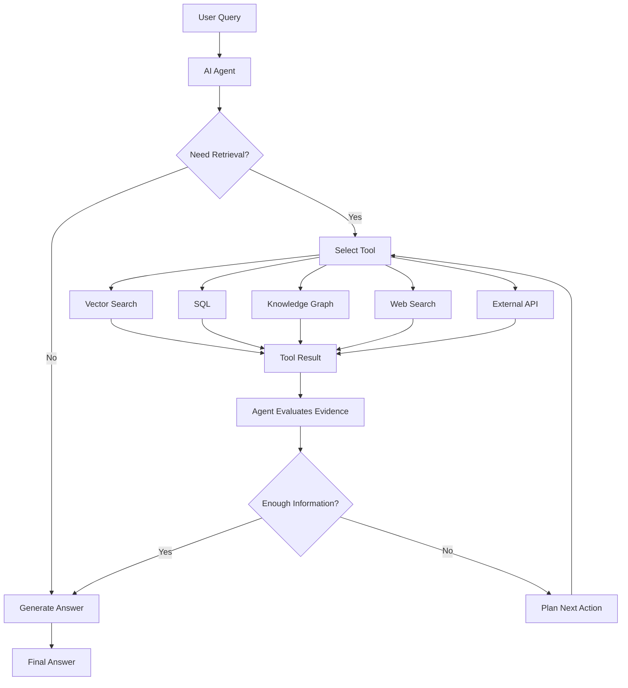

Unlike a fixed RAG pipeline, the retrieval path can change for every question.

---

# 🤖 Why Agentic RAG?

Consider three different questions.

### Question 1

```text
What is Neo4j?
```

A vector knowledge base may be enough.

```text
User
 ↓
Agent
 ↓
Vector Search
 ↓
Answer
```

### Question 2

```text
What were our total sales last month?
```

A SQL database is more appropriate.

```text
User
 ↓
Agent
 ↓
SQL
 ↓
Answer
```

### Question 3

```text
Which companies acquired AI startups
and what are their latest products?
```

This might require:

```text
Knowledge Graph
       +
Web Search
       +
Internal Documents
       ↓
Combined Answer
```

A fixed retriever may not handle all three situations effectively.

An agent can decide which tools are appropriate.

---

# 🔄 ReAct Control Loop

Agentic RAG is commonly associated with the **ReAct (Reasoning + Acting)** pattern.

Conceptually:

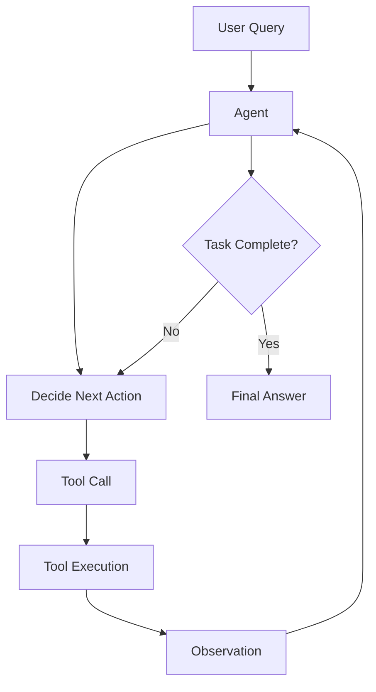

The loop is:

```text
Reason
  ↓
Act
  ↓
Observe
  ↓
Reason
  ↓
Act
  ↓
Observe
  ↓
Answer
```

The important difference from standard RAG is that **the agent can repeat this process dynamically**.

---

# 🧰 Tools

Agentic RAG becomes powerful when the agent has access to multiple specialized tools.

For example:

```text
search_knowledge_base()
search_web()
query_database()
search_graph()
get_document()
calculate()
```

The agent decides which tool is appropriate.

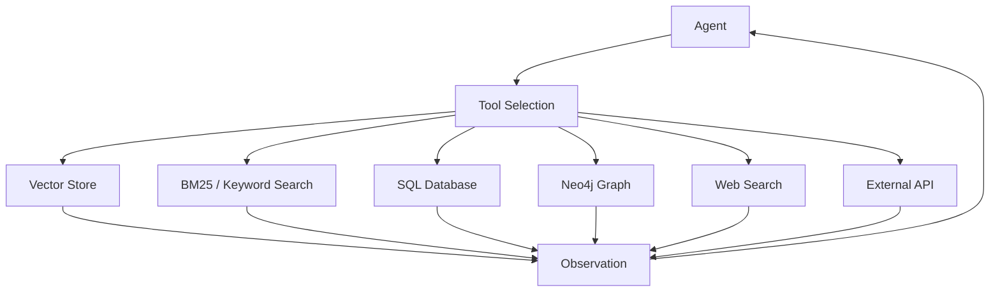

This turns retrieval into a **tool-use problem**.

---

# 🔎 Agent Decides Whether Retrieval Is Needed

One important characteristic of Agentic RAG is that retrieval is not necessarily mandatory.

Consider:

```text id="a4b0f4"
User:
What is 2 + 2?
```

The agent may answer directly.

But:

```text id="jz2q4a"
User:
What is our company's refund policy?
```

The agent should retrieve the relevant internal document.

Conceptually:

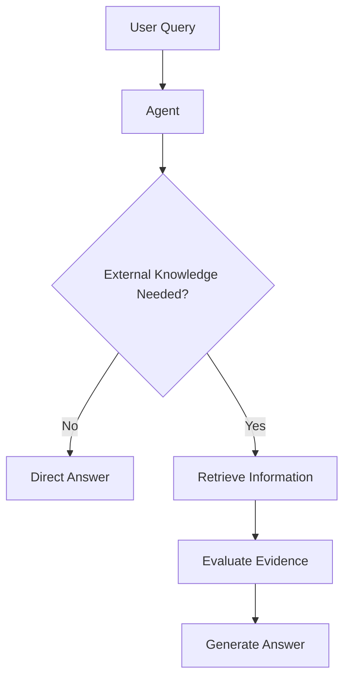

This is one of the major differences from traditional RAG.

---

# 🧠 Dynamic Retrieval

In traditional RAG, the retrieval pipeline is generally predetermined:

```text
Query
 ↓
Embedding
 ↓
Vector Search
 ↓
Top-K
```

Agentic RAG can dynamically choose:

```text
Query
 ↓
Agent
 ↓
Should I use:
 ├── Vector Search?
 ├── SQL?
 ├── Graph?
 ├── Web?
 └── Multiple tools?
```

The agent can also decide **how many times to retrieve**.

---

# 🔁 Multi-Step Retrieval

Suppose the user asks:

```text
Which startups acquired by ACME Corp
have AI-related patents?
```

An agent could perform:

### Step 1

Search the knowledge graph:

```text
ACME Corp
   ↓
ACQUIRED
   ↓
Startups
```

### Step 2

For each relevant startup, retrieve patents.

```text
Startup
   ↓
HAS_PATENT
   ↓
Patent
```

### Step 3

Use vector search to find text describing AI relevance.

### Step 4

Rerank the evidence.

### Step 5

Synthesize the final answer.

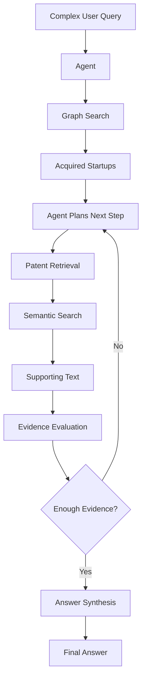

This is closely related to **Multi-Hop RAG**, but the key difference is that the **agent dynamically decides the retrieval steps and tools**.

---

# 🔥 Agentic RAG vs Multi-Hop RAG

These concepts are related but not identical.

### Multi-Hop RAG

The retrieval process follows dependent steps:

```text
Query
 ↓
Hop 1
 ↓
Finding
 ↓
Hop 2
 ↓
Finding
 ↓
Answer
```

The main focus is:

> **Sequential retrieval across multiple pieces of information.**

### Agentic RAG

The agent controls the process:

```text
Query
 ↓
Agent
 ↓
Choose action
 ↓
Observe
 ↓
Choose next action
 ↓
Observe
 ↓
Answer
```

The main focus is:

> **Dynamic decision-making and tool orchestration.**

Therefore:

> **Multi-Hop can be implemented inside Agentic RAG.**

---

# 🧩 Agentic RAG + GraphRAG

Agentic RAG can use the knowledge graph from Lab 13 as one of its tools.

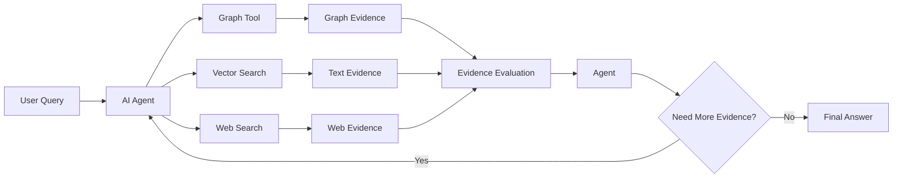

For relationship-heavy questions, the agent might select the graph tool.

For semantic questions, it might choose vector search.

For current external information, it might use web search.

---

# 🔀 Agentic RAG + Hybrid Retrieval

A single tool can itself contain an entire retrieval architecture.

For example:

```text
search_knowledge_base()
```

could internally perform:

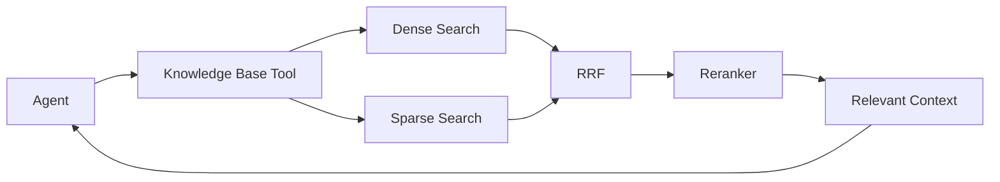

So the agent does not necessarily need to manage every low-level retrieval operation.

This gives a useful abstraction:

```text
Agent
  ↓
High-Level Tools
  ↓
Specialized Retrieval Pipelines
```

---

# 🧠 Tool Selection

A good Agentic RAG system needs to select the appropriate tool.

For example:

| User Question                                | Likely Tool             |
| -------------------------------------------- | ----------------------- |
| "What is RAG?"                               | Vector Search           |
| "Find documents mentioning error `ERR_401`"  | Keyword Search          |
| "What were sales last month?"                | SQL                     |
| "Which company acquired Startup X?"          | Graph                   |
| "What happened today?"                       | Web Search              |
| "What does our policy say?"                  | Internal Knowledge Base |
| "Compare our sales with current market data" | SQL + Web               |

The agent can dynamically combine tools when necessary.

---

# 🛠️ Tool Calling

Conceptually, the agent might produce a structured tool call:

```json
{
  "tool": "search_knowledge_base",
  "arguments": {
    "query": "Neo4j graph database architecture"
  }
}
```

The application executes the tool and returns the result.

The agent then receives the observation and decides what to do next.

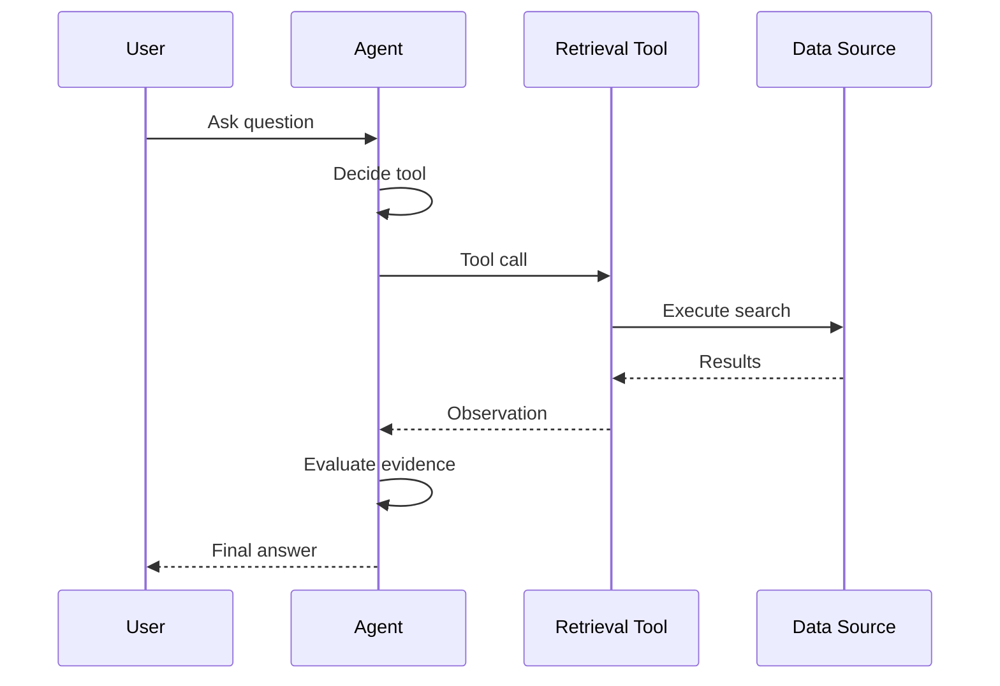

---

# 📊 Evidence Evaluation

A major benefit of Agentic RAG is that the agent can evaluate whether retrieved information is sufficient.

For example:

```text id="5c87fc"
Query:
What are the security limitations of Product X?
```

The agent retrieves one document.

It determines:

```text
Retrieved evidence:
Covers authentication
Does not cover data retention
```

Instead of immediately answering, the agent can perform another search:

```text
search_kb("Product X data retention security")
```

Then combine both results.

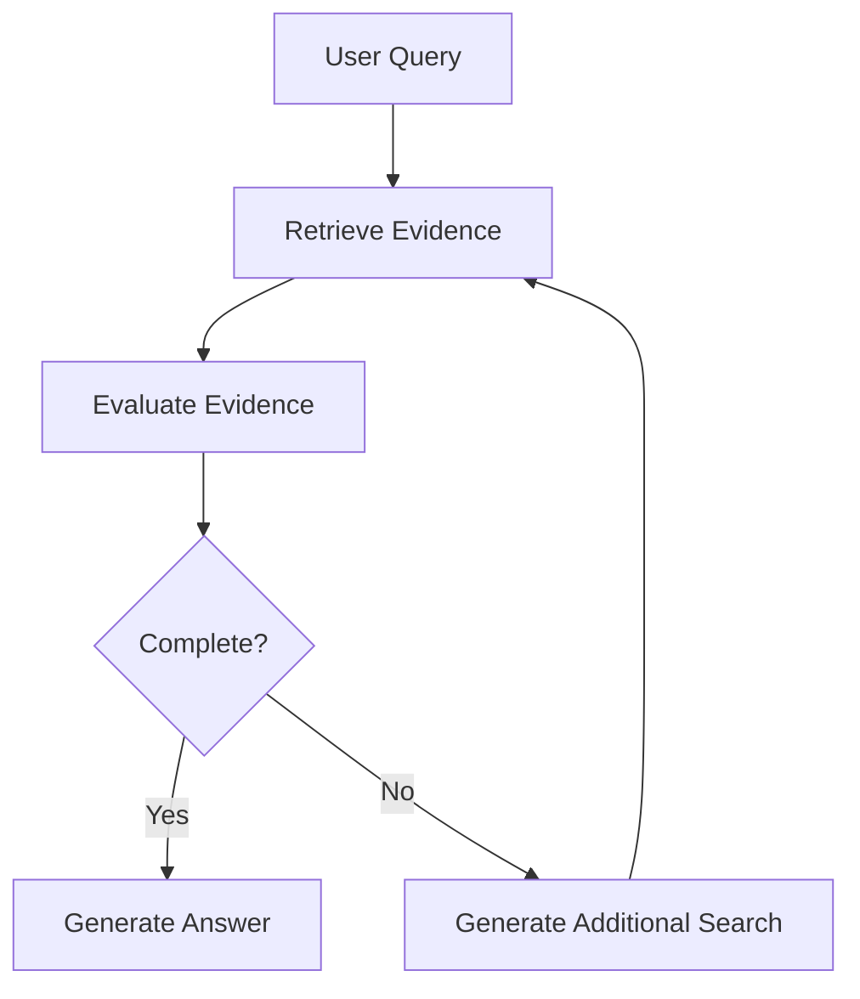

This makes retrieval **iterative rather than one-shot**.

---

# 🛑 Stopping Conditions

Agentic systems need explicit stopping conditions.

Otherwise, an agent could continue searching unnecessarily.

Useful limits include:

### Maximum Iterations

```text
max_steps = 5
```

### Maximum Tool Calls

```text
max_tool_calls = 10
```

### Token Budget

Limit the total context and reasoning budget.

### Time Limit

Stop after a defined execution window.

### Confidence / Evidence Threshold

Stop when sufficient evidence has been collected.

Conceptually:

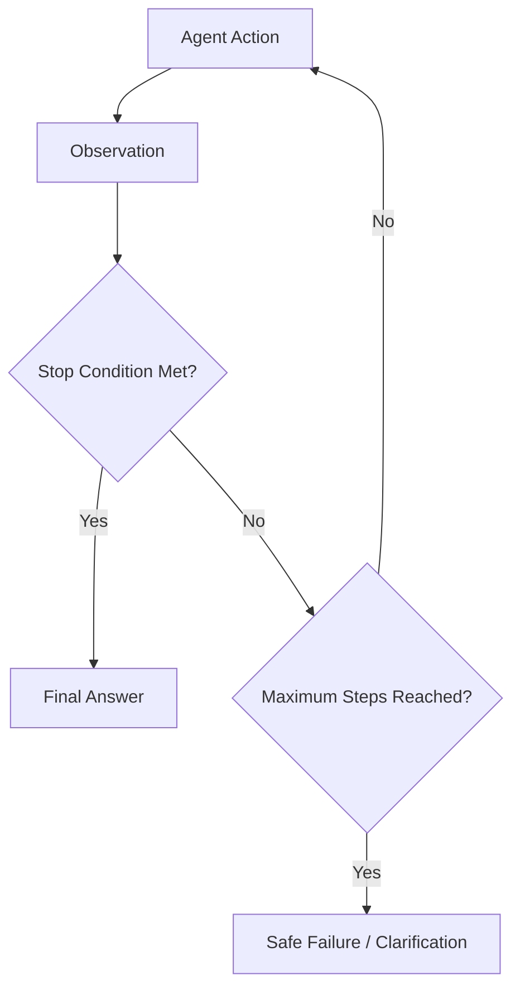

---

# ⚠️ Error Propagation

Agentic RAG introduces a new class of failures.

Suppose:

```text
Agent chooses wrong tool
        ↓
Wrong retrieval
        ↓
Incorrect observation
        ↓
Wrong next action
        ↓
Incorrect final answer
```

Because decisions are sequential, an early mistake can influence later steps.

Therefore production systems should use:

* Tool validation
* Structured outputs
* Retrieval limits
* Evidence checks
* Maximum iteration limits
* Source citations/provenance
* Observability and tracing
* Permission checks

---

# 🔐 Tool Permissions

This becomes especially important when agents can access private or external systems.

For example:

```text
Agent
 ├── Vector Search       → Allowed
 ├── SQL Read            → Allowed
 ├── SQL Write           → Not Allowed
 ├── Web Search          → Allowed
 └── Admin API           → Not Allowed
```

The agent should **not** be trusted to enforce permissions by itself.

Authorization should be enforced by the application/tool layer.

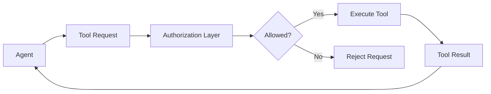

This is especially important for multi-tenant applications.

---

# 🔍 Agentic RAG vs Traditional RAG

| Feature                  | Traditional RAG       | Agentic RAG      |
| ------------------------ | --------------------- | ---------------- |
| Fixed retrieval flow     | ✅                     | Optional         |
| Dynamic tool selection   | ❌                     | ✅                |
| Multiple retrieval steps | Limited               | ✅                |
| SQL integration          | Possible              | Natural          |
| Graph integration        | Possible              | Natural          |
| Web search               | Possible              | Natural          |
| Retrieval decision       | Usually predetermined | Agent-controlled |
| Evidence evaluation      | Limited               | ✅                |
| Iterative retrieval      | Limited               | ✅                |
| Complexity               | Lower                 | Higher           |
| Latency predictability   | Better                | Lower            |
| Debugging                | Easier                | Harder           |

---

# 🔄 Traditional RAG vs Agentic RAG

### Traditional RAG

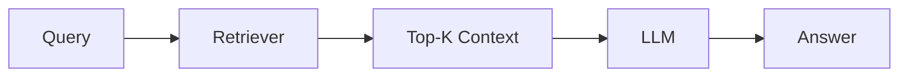

The application determines the retrieval path.

### Agentic RAG

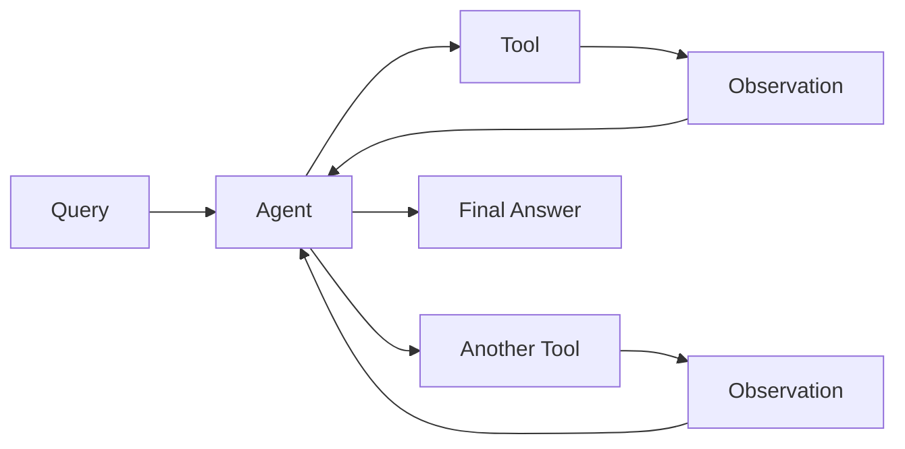

The agent determines the path dynamically.

---

# 🏭 Production-Oriented Agentic RAG

A robust architecture might look like:

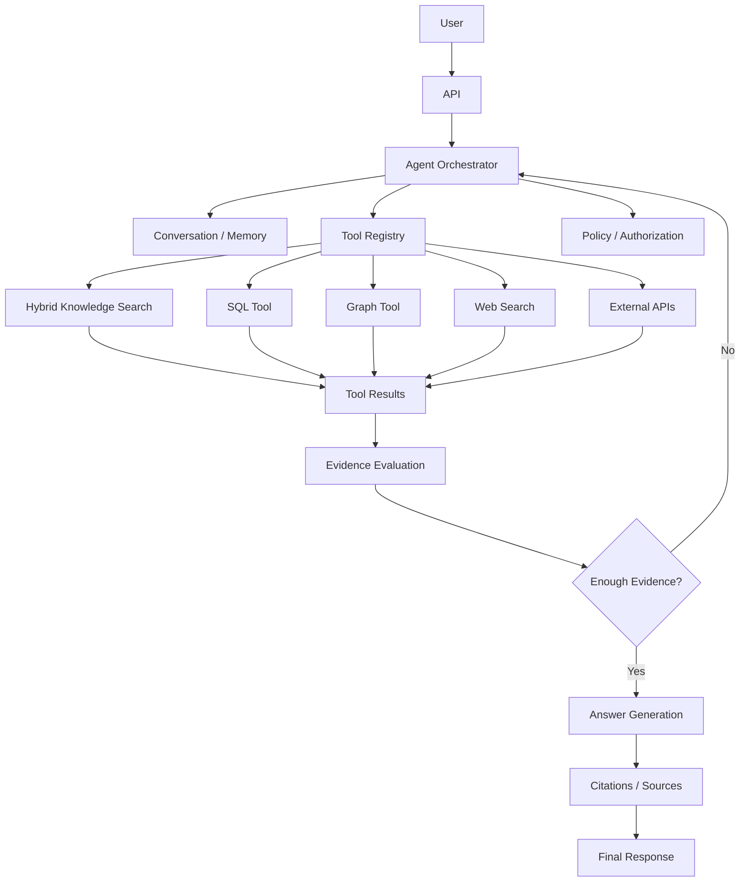

---

# 🧩 Agentic RAG Is an Orchestration Layer

This is one of the most important concepts in this lab.

Agentic RAG does not necessarily replace:

* Vector RAG
* Hybrid RAG
* Reranking
* GraphRAG
* Multi-Hop RAG
* Metadata filtering

Instead, the **agent can orchestrate them**.

For example:

```text
                    Agent
                      │
       ┌──────────────┼──────────────┐
       ↓              ↓              ↓
  Hybrid RAG      GraphRAG       Web Search
       │              │              │
       └──────────────┼──────────────┘
                      ↓
               Evidence Evaluation
                      ↓
                     LLM
```

So think of Agentic RAG as a **control/orchestration layer around retrieval capabilities**.

---

# ⚠️ When Agentic RAG Is Overkill

Not every application needs an agent.

For:

```text
"What is our refund policy?"
```

a simple:

```text
Query
 ↓
Retriever
 ↓
Reranker
 ↓
LLM
```

may be faster, cheaper, and easier to debug.

An agent becomes more valuable when:

* Different questions require different tools
* Retrieval needs multiple steps
* The correct retrieval strategy is unknown beforehand
* External APIs are involved
* SQL + vector + graph information must be combined
* The system needs iterative evidence gathering
* Tasks require planning and tool orchestration

---

# ⚖️ Tradeoffs

### Advantages

* Dynamic retrieval decisions
* Multiple tools and data sources
* Iterative evidence gathering
* Supports complex multi-step questions
* Can combine vector, SQL, graph, and web retrieval
* Can evaluate whether more information is required
* Flexible for complex AI applications

### Disadvantages

* Higher latency
* Higher token/tool costs
* More complex architecture
* Less predictable execution
* More difficult debugging
* Risk of tool-selection errors
* Risk of loops or unnecessary tool calls
* Requires strong permission and safety controls

---

# 🧠 Key Mental Model

Traditional RAG asks:

> **"What documents should I retrieve for this query?"**

Agentic RAG asks:

> **"What should I do next to answer this question correctly?"**

The agent can decide:

```text
Do I need retrieval?
       ↓
Which tool?
       ↓
What query?
       ↓
Is the result useful?
       ↓
Do I need another tool?
       ↓
Do I have enough evidence?
       ↓
Generate answer
```

The complete mental model is:

```text
User Query
    ↓
   Agent
    ↓
Plan / Decide
    ↓
Select Tool
    ↓
Execute Tool
    ↓
Observe Result
    ↓
Evaluate Evidence
    │
    ├── Insufficient → Next Action → Tool
    │
    └── Sufficient → Generate Answer
```

---

# 📌 Key Takeaway

**Agentic RAG = RAG + Agent + Tools + Dynamic Decision-Making**

Traditional RAG follows a mostly predetermined retrieval pipeline:

```text
Query → Retrieve → Context → LLM
```

Agentic RAG introduces a decision-making loop:

```text
Query
  ↓
Agent
  ↓
Choose Tool
  ↓
Observe
  ↓
Evaluate
  ↓
Choose Next Action
  ↓
...
  ↓
Final Answer
```

The most important distinction is:

> **Traditional RAG retrieves because the pipeline says to retrieve.**

> **Agentic RAG retrieves because the agent decides retrieval or another tool is needed.**

And the broader architecture to remember is:

> **Agentic RAG is an orchestration layer that can dynamically combine Vector RAG, Hybrid RAG, GraphRAG, SQL, Web Search, Multi-Hop retrieval, and other tools to solve complex information-seeking tasks.**
