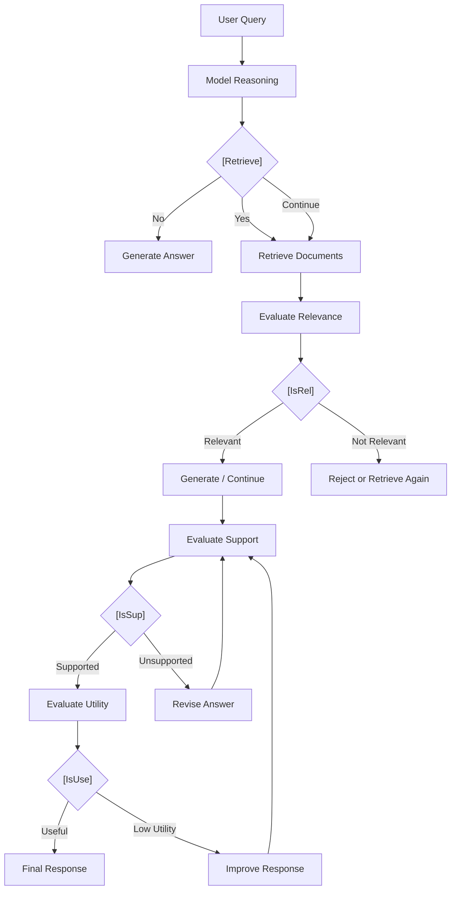
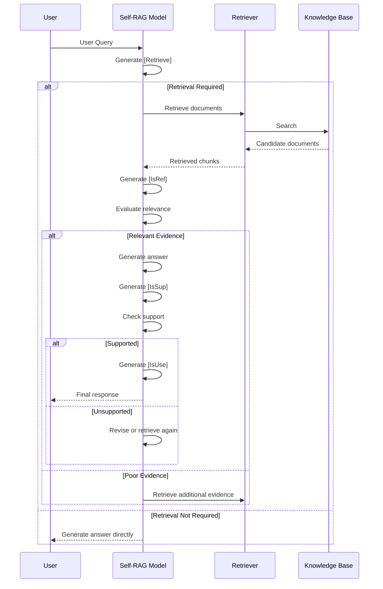
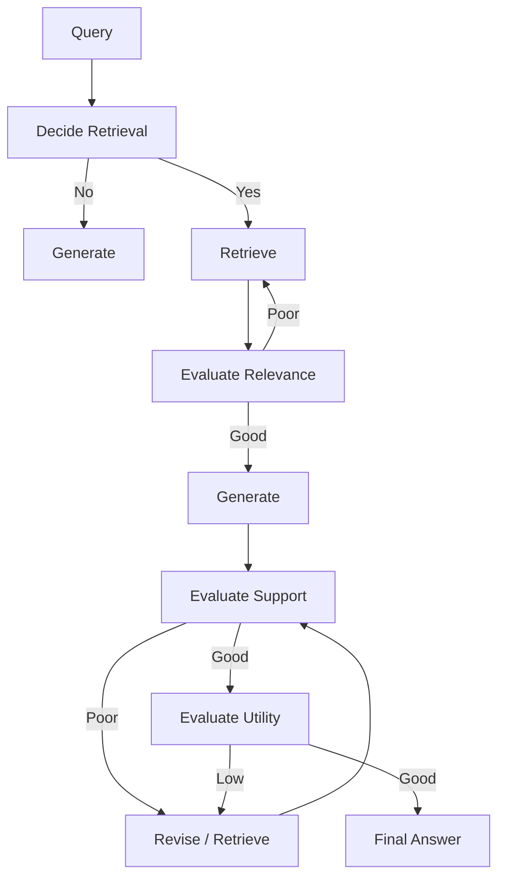
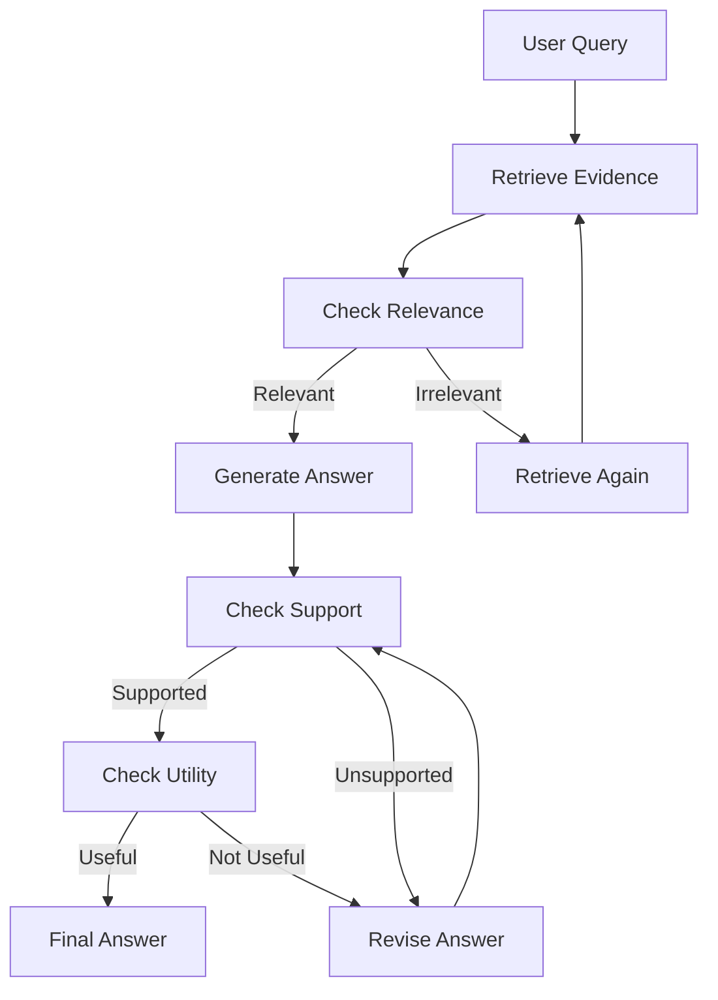
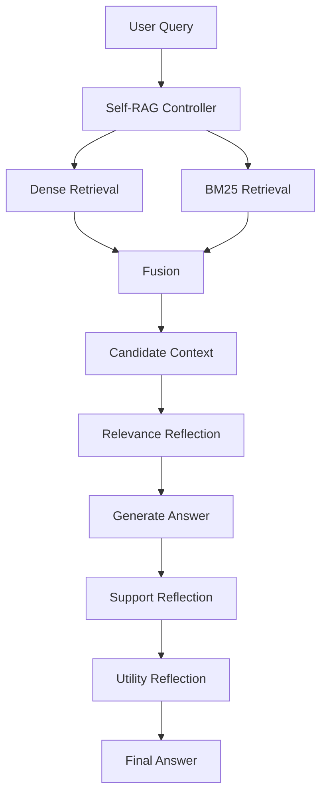
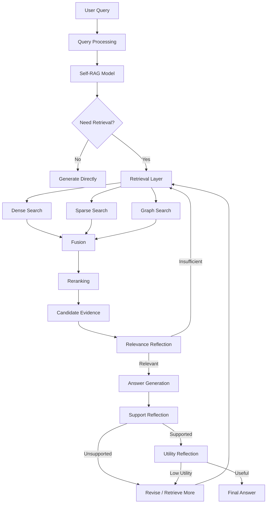

# 16 — Self-RAG (Self-Reflective RAG)

## 📌 Overview

**Self-RAG (Self-Reflective Retrieval-Augmented Generation)** extends traditional RAG by allowing the model to **decide when retrieval is needed and reflect on the quality of retrieved evidence and generated responses**.

Traditional RAG usually follows a fixed pipeline:

> Query → Retrieve → Generate

Self-RAG makes this process adaptive:

> Query → Decide → Retrieve → Reflect → Generate → Reflect → Continue / Stop

The key idea is to use special **reflection tokens** that allow the model to evaluate:

* Whether retrieval is necessary
* Whether retrieved information is relevant
* Whether the generated answer is supported by the evidence
* Whether the final response is useful

This makes RAG less of a fixed pipeline and more of a **self-evaluating retrieval and generation process**.

---

# 🧠 Why Self-RAG?

A traditional RAG system may retrieve documents for every question, even when retrieval is unnecessary.

For example:

> **Question:** What is 2 + 2?

Retrieving documents from a knowledge base is unnecessary.

But:

> **Question:** What are the latest changes in India's AI regulations?

External or up-to-date retrieval may be necessary.

A static RAG pipeline cannot naturally distinguish between these cases.

Self-RAG attempts to make this decision dynamically.

### Traditional RAG


### Self-RAG



---

# 🔍 Reflection Tokens

Self-RAG uses special reflection tokens to represent the model's decisions and evaluations.

The major reflection signals are:

| Reflection Token | Purpose                                                          |
| ---------------- | ---------------------------------------------------------------- |
| `[Retrieve]`     | Decide whether retrieval should happen                           |
| `[IsRel]`        | Evaluate whether retrieved content is relevant                   |
| `[IsSup]`        | Evaluate whether the response is supported by retrieved evidence |
| `[IsUse]`        | Evaluate the usefulness of the generated response                |

These signals provide explicit feedback during the generation process.

---

# 1️⃣ `[Retrieve]` — Should We Retrieve?

The model first determines whether external knowledge is necessary.

Conceptually:

```text
[Retrieve] = Yes
[Retrieve] = No
[Retrieve] = Continue
```

### Example

**Query:**

> What is the capital of France?

The model may decide:

```text
[Retrieve] = No
```

because the answer is well-known.

For:

> What were the major announcements in OpenAI's latest developer event?

The model may decide:

```text
[Retrieve] = Yes
```

because the information may be recent or outside its reliable internal knowledge.

### Why this matters

Retrieval has costs:

* Embedding computation
* Vector/database queries
* Reranking
* Network latency
* Context tokens
* External search costs

Self-RAG can avoid unnecessary retrieval when the model already has sufficient knowledge.

---

# 2️⃣ `[IsRel]` — Is the Retrieved Evidence Relevant?

After retrieving documents, Self-RAG evaluates whether the retrieved passages actually help answer the question.

### Example

**Question:**

> How does Kubernetes handle container restarts?

Retrieved chunk:

> "Kubernetes uses Pods as the smallest deployable units..."

This may be related to Kubernetes but does not directly answer container restart behavior.

The model may evaluate:

```text
[IsRel] = No
```

Another chunk:

> "The kubelet restarts containers according to the Pod's restart policy..."

This is much more relevant:

```text
[IsRel] = Yes
```

### Why `[IsRel]` matters

A vector database can return semantically similar content that is still not useful enough to answer the question.

Therefore:

> **Retrieved ≠ Relevant**

Self-RAG explicitly evaluates this distinction.

---

# 3️⃣ `[IsSup]` — Is the Answer Supported?

After generating an answer, Self-RAG checks whether the claims are actually supported by the retrieved evidence.

This helps reduce hallucinations.

### Example

**Retrieved context:**

> React Native allows developers to build native mobile applications using JavaScript and React.

**Generated answer:**

> React Native allows developers to build mobile applications using JavaScript and React.

The answer is supported:

```text
[IsSup] = Yes
```

But if the model generates:

> React Native was created in 2013 and officially launched in 2015.

when that information does not appear in the retrieved context, the model may identify a support problem:

```text
[IsSup] = No
```

The model can then revise the response or retrieve additional evidence.

### Important distinction

`[IsSup]` is about **support from evidence**, not simply whether the answer sounds correct.

This is important because an LLM can produce a plausible statement that is not grounded in the retrieved documents.

---

# 4️⃣ `[IsUse]` — Is the Response Useful?

Even when an answer is relevant and supported, it may still be poorly useful.

For example:

> **Question:** How do I implement pagination in React?

Response:

> "Pagination is a technique used to divide data into pages."

This is factually reasonable, but not very useful to someone trying to implement it.

Self-RAG can evaluate the usefulness of the response.

Conceptually:

```text
[IsUse] = Low
```

The model can then improve the answer with:

* Implementation details
* Code
* Examples
* Explanation
* Relevant caveats

The original Self-RAG work represents usefulness with a graded reflection signal rather than treating it simply as a binary yes/no decision.

---

# 🔄 Complete Self-RAG Workflow

A simplified Self-RAG process looks like this:



---

# 🧩 Self-RAG vs Traditional RAG

The biggest difference is **control and reflection**.

### Traditional RAG


### Self-RAG



The important difference is:

> **Traditional RAG retrieves first and generates afterward.**

> **Self-RAG dynamically decides, retrieves, reflects, and can revise.**

---

# 🧠 Reflection During Generation

One of the interesting aspects of Self-RAG is that reflection is integrated into the generation process rather than being treated purely as a separate post-processing step.

Conceptually:

```text
User Query
    ↓
[Retrieve]
    ↓
Retrieved Passage
    ↓
[IsRel]
    ↓
Generate Response
    ↓
[IsSup]
    ↓
[IsUse]
    ↓
Final Response
```

The model can therefore make decisions based on intermediate evidence.

---

# 🔁 Self-Correction Loop

A major benefit of Self-RAG is the ability to revise a weak response.

For example:



This creates a feedback loop:

> **Retrieve → Evaluate → Generate → Evaluate → Revise**

rather than:

> **Retrieve → Generate → Stop**

---

# 🎯 Example

Imagine a user asks:

> **"Which database is better for GraphRAG: Neo4j or PostgreSQL?"**

A basic RAG system might:

1. Embed the question.
2. Search the vector database.
3. Retrieve several chunks.
4. Send them to the LLM.
5. Generate an answer.

Self-RAG can reason more adaptively:

```text
User Query
    ↓
[Retrieve] = Yes
    ↓
Retrieve GraphRAG documents
    ↓
[IsRel]
    ↓
Some documents are relevant
    ↓
Generate comparison
    ↓
[IsSup]
    ↓
One claim isn't supported
    ↓
Retrieve additional evidence
    ↓
Generate revised answer
    ↓
[IsUse]
    ↓
Useful
    ↓
Final Answer
```

The system doesn't blindly trust the first retrieval result.

---

# 🆚 Self-RAG vs CRAG

Self-RAG and Corrective RAG are related but solve the problem differently.

| Feature                             | CRAG                             | Self-RAG                               |
| ----------------------------------- | -------------------------------- | -------------------------------------- |
| Retrieval evaluation                | ✅                                | ✅                                      |
| Retrieval correction                | ✅                                | ✅                                      |
| Explicit reflection                 | Limited / architecture-dependent | ✅                                      |
| Decides whether retrieval is needed | Not necessarily                  | ✅                                      |
| Evaluates retrieved relevance       | ✅                                | ✅                                      |
| Evaluates answer support            | Can be added                     | Core concept                           |
| Evaluates response utility          | Not necessarily                  | ✅                                      |
| Dynamic generation control          | Limited                          | ✅                                      |
| Reflection tokens                   | ❌                                | ✅                                      |
| Main idea                           | Correct bad retrieval            | Self-reflective retrieval + generation |

### Mental model

**CRAG:**

> "Are my retrieved documents good enough? If not, correct the retrieval."

**Self-RAG:**

> "Do I need retrieval? Is the evidence relevant? Is my answer supported? Is it useful? If not, improve it."

---

# 🆚 Self-RAG vs Agentic RAG

These architectures can look similar because both can perform dynamic retrieval.

| Feature                 | Self-RAG                           | Agentic RAG                            |
| ----------------------- | ---------------------------------- | -------------------------------------- |
| Dynamic retrieval       | ✅                                  | ✅                                      |
| Self-evaluation         | ✅                                  | Optional                               |
| Reflection signals      | Core                               | Optional                               |
| Tool selection          | Not necessarily                    | ✅                                      |
| Multiple external tools | Not required                       | Common                                 |
| Planning                | Limited / model-driven             | Often explicit                         |
| Web / SQL / Graph tools | Possible                           | Common                                 |
| Main focus              | Reflection and grounded generation | Tool orchestration and decision-making |

A useful distinction:

> **Self-RAG focuses on reflection.**

> **Agentic RAG focuses on action and orchestration.**

They can also be combined.

---

# 🔗 Self-RAG + Hybrid Retrieval

Self-RAG does not require a specific retrieval method.

It can work with:

* Vector search
* BM25
* Hybrid search
* Graph retrieval
* SQL
* External search

For example:



This can combine several techniques learned in previous labs.

---

# 🔗 Self-RAG + Reranking

Reranking and Self-RAG solve different problems.

### Reranker

Answers:

> **"Which of these retrieved documents are the most relevant?"**

### Self-RAG

Answers:

> **"Is the evidence sufficient, is my answer grounded, and is the result useful?"**

A production pipeline might therefore be:

```text
Query
 ↓
Hybrid Retrieval
 ↓
Top 50 Candidates
 ↓
Reranker
 ↓
Top 5–10 Chunks
 ↓
Self-RAG Reflection
 ↓
Generate
 ↓
Support Check
 ↓
Utility Check
 ↓
Answer
```

---

# 🏗️ Production-Oriented Architecture

A more complete Self-RAG system could look like:



This architecture combines concepts from many previous labs:

* Hybrid RAG
* Reranking
* GraphRAG
* Corrective RAG
* Self-RAG

---

# ⚠️ Important: Self-RAG Is More Than a Prompt

A common misunderstanding is:

> "I can just tell an LLM to critique its answer and call it Self-RAG."

That captures the **idea of self-reflection**, but it is not equivalent to the original Self-RAG approach.

The Self-RAG research introduced a model trained to use reflection tokens during retrieval and generation.

In a practical application, however, you can implement **Self-RAG-inspired behavior** using:

* Structured outputs
* Reflection steps
* Retrieval decisions
* Relevance graders
* Groundedness checks
* Utility evaluation
* Retry loops
* Tool calling

So it's useful to distinguish:

> **Self-RAG-inspired application architecture**
> from
> **the specific trained Self-RAG model approach described in the research.**

---

# ⚠️ Common Failure Modes

### 1. Reflection Loop

The model continuously decides:

```text
Retrieve → Reflect → Retrieve → Reflect → ...
```

**Solution:**

Set:

* Maximum retrieval attempts
* Maximum reflection iterations
* Maximum token budget
* Timeout

---

### 2. Incorrect Self-Evaluation

An LLM can incorrectly judge its own answer as supported.

Self-reflection is therefore **not a perfect hallucination detector**.

For high-stakes applications, combine reflection with:

* Independent evaluators
* Citation verification
* Rule-based validation
* Structured evidence checks
* External evaluation

---

### 3. Over-Retrieval

The model may retrieve information even when it already knows the answer.

This increases:

* Latency
* Cost
* Context size

The retrieval decision should therefore be calibrated to the application's needs.

---

### 4. Under-Retrieval

The model may incorrectly decide:

```text
[Retrieve] = No
```

even though external evidence is necessary.

This is especially problematic for:

* Current information
* Private company data
* User-specific information
* Frequently changing facts
* Specialized knowledge

---

### 5. Reflection Cost

Every additional evaluation step consumes computation and potentially tokens.

Self-RAG can therefore be more expensive than a simple RAG pipeline.

---

# 📊 Traditional RAG vs Self-RAG

| Capability             |                 Basic RAG | Self-RAG |
| ---------------------- | ------------------------: | -------: |
| Retrieval              |                     Fixed |  Dynamic |
| Retrieval decision     |                         ❌ |        ✅ |
| Relevance evaluation   | Usually external/optional |        ✅ |
| Answer grounding check |          Usually optional |        ✅ |
| Utility evaluation     |          Usually optional |        ✅ |
| Self-correction        |                   Limited |        ✅ |
| Reflection tokens      |                         ❌ |        ✅ |
| Adaptive retrieval     |                         ❌ |        ✅ |
| Complexity             |                       Low |     High |
| Cost                   |                     Lower |   Higher |
| Control                |                    Static | Adaptive |

---

# ⚖️ Tradeoffs

### ✅ Advantages

* Reduces unnecessary retrieval
* Improves retrieval quality through reflection
* Helps detect unsupported claims
* Can improve answer grounding
* Can revise weak responses
* Supports adaptive retrieval
* Works with different retrieval strategies
* Provides a richer control mechanism than fixed RAG

### ❌ Disadvantages

* More computationally expensive
* More complex architecture
* Reflection itself can be incorrect
* Can introduce additional latency
* Requires stopping conditions
* More difficult to debug
* May require specialized model training for the original Self-RAG approach

---

# 🧠 Key Mental Model

Think of traditional RAG as:

```text
Retrieve → Generate
```

CRAG as:

```text
Retrieve → Evaluate → Correct if Necessary
```

Self-RAG as:

```text
Decide
   ↓
Retrieve
   ↓
Reflect
   ↓
Generate
   ↓
Reflect
   ↓
Revise / Continue / Stop
```

The core idea is:

> **Don't blindly retrieve. Don't blindly trust retrieved evidence. And don't blindly trust the generated answer.**

Self-RAG introduces reflection into the RAG loop so the model can dynamically evaluate and improve its own retrieval and generation process.

---

# 📌 Key Takeaway

**Self-RAG = Retrieval + Reflection + Adaptive Generation**

The four important concepts are:

```text
[Retrieve]
    ↓
Should I retrieve?

[IsRel]
    ↓
Is the retrieved evidence relevant?

[IsSup]
    ↓
Is my answer supported by the evidence?

[IsUse]
    ↓
Is my answer actually useful?
```

The fundamental shift is:

> **Traditional RAG:** Retrieve → Generate

> **Self-RAG:** Decide → Retrieve → Reflect → Generate → Reflect → Improve

Self-RAG is therefore an important step toward **adaptive and self-evaluating RAG systems**, and it naturally connects the earlier concepts of **reranking, corrective retrieval, agentic workflows, and grounded generation**.
