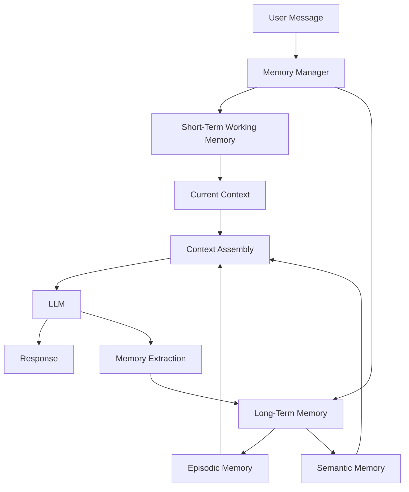
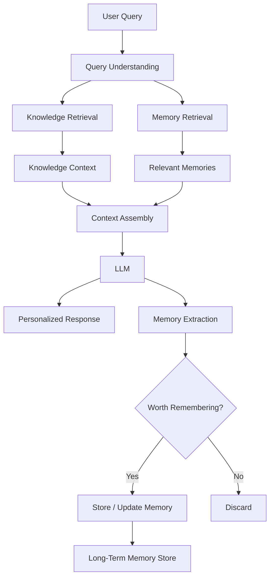
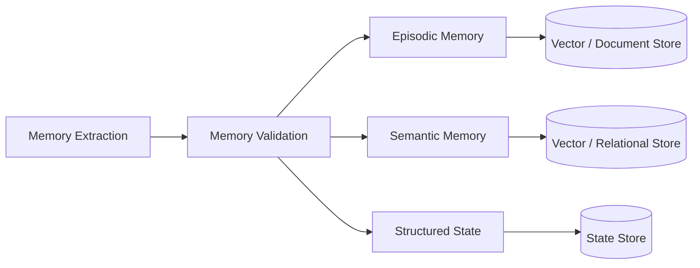
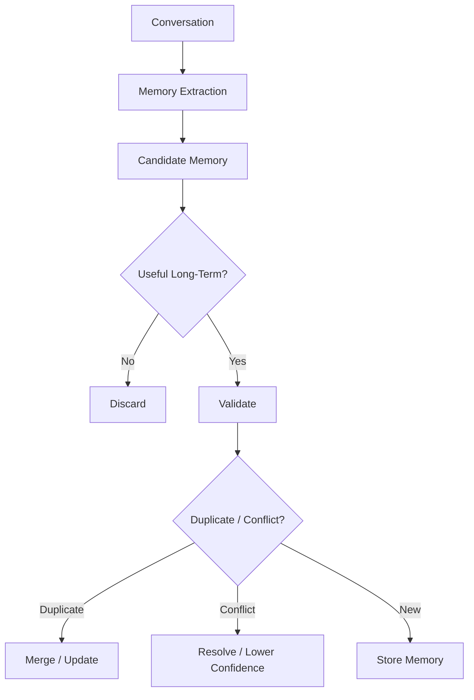
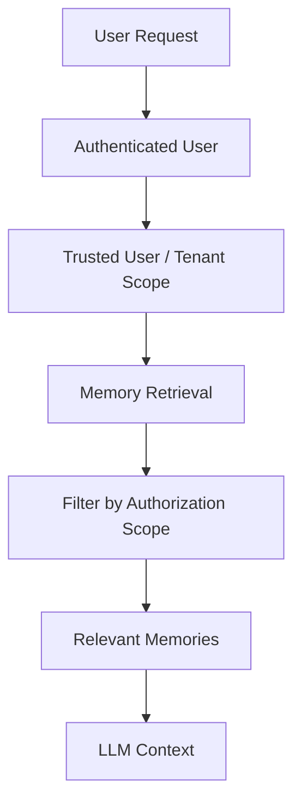
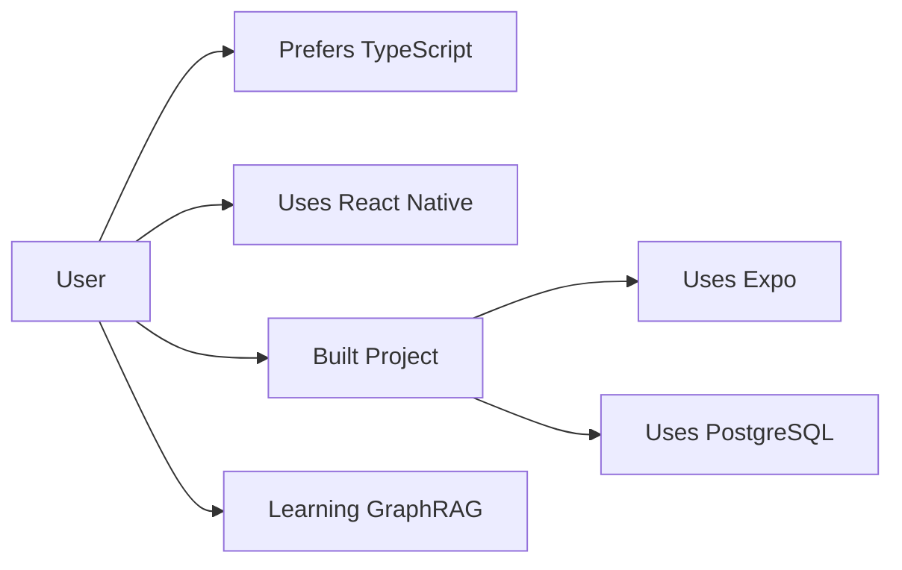
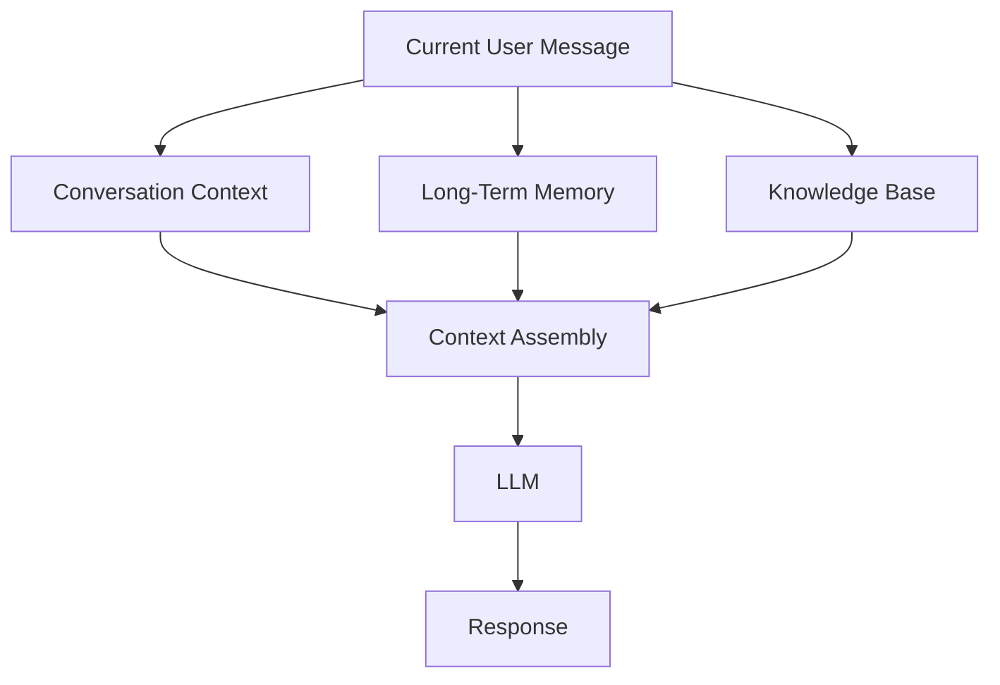
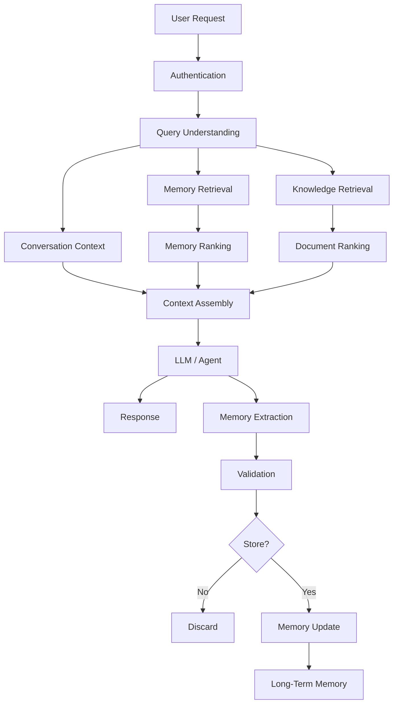
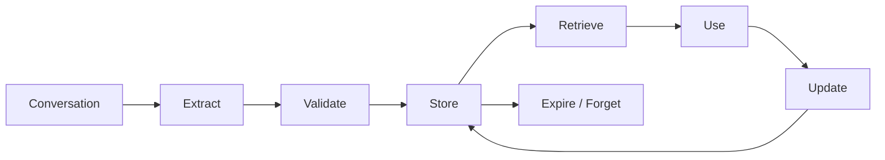

# 17 — Memory-Augmented RAG

## 📌 Overview

**Memory-Augmented RAG** extends traditional RAG by adding **persistent memory** to the retrieval system.

Traditional RAG retrieves information from a knowledge base:

> **User Query → Retrieve Documents → Generate Answer**

Memory-Augmented RAG additionally retrieves information about **previous interactions, user preferences, past events, and learned facts**:

> **User Query → Retrieve Knowledge + Retrieve Memory → Generate Personalized Answer**

This allows an AI system to maintain useful information across conversations and sessions.

Examples of information that can be stored in memory:

* User preferences
* Previous conversation facts
* Past decisions
* Important events
* User goals
* Frequently used configurations
* Agent task state
* Learned relationships between entities

---

# 🧠 Why Memory-Augmented RAG?

An ordinary RAG system might know:

> "React Native supports Android and iOS."

But it may not know that:

> "This particular user prefers Expo for React Native projects."

That preference may have been discussed several conversations ago.

Memory allows the system to retrieve this historical information when it becomes relevant.

### Without Memory

```text
User: I prefer Expo for my React Native projects.

... Later ...

User: How should I set up this mobile app?

AI: Here are several React Native setup options...
```

The system may not remember the preference.

### With Memory

```text
User: How should I set up this mobile app?

Memory:
"User prefers Expo for React Native projects."

AI:
"Since you prefer Expo, I recommend starting with..."
```

The system can therefore provide more personalized responses.

---

# 🏗️ Dual-Memory Architecture

A useful conceptual model is to separate **short-term working memory** from **long-term memory**.



### Short-Term Working Memory

Information currently available in the model's context window.

Examples:

* Current conversation
* Recent messages
* Current task
* Retrieved documents
* Intermediate reasoning state

### Long-Term Memory

Information persisted outside the context window.

Examples:

* User preferences
* Past events
* Historical facts
* Learned user information
* Previous task outcomes

---

# 🧩 Types of Memory

Memory-Augmented RAG commonly benefits from separating memory into different categories.

## 1️⃣ Short-Term / Working Memory

This is the model's immediate working context.

```text id="zjfl8v"
Current conversation
      ↓
Recent messages
      ↓
Retrieved documents
      ↓
Current task state
```

It is typically temporary and constrained by the model's context window.

### Example

```text
User:
Create a React Native authentication screen.

Assistant:
Sure. We'll use Expo Router...

User:
Now add Google login.

Assistant:
...
```

The current conversation provides working memory for understanding:

> "Now add Google login."

---

# 2️⃣ Episodic Memory

**Episodic memory stores events and experiences from previous interactions.**

Think:

> **"What happened?"**

Examples:

```text id="8gd9qf"
User previously built a React Native application.
User selected Expo Router for navigation.
User decided to use PostgreSQL for the backend.
User previously debugged an authentication issue.
```

These are historical events rather than general facts.

### Example

```text
Memory:
{
  "type": "episodic",
  "event": "User selected Expo Router",
  "project": "Mobile App",
  "timestamp": "2026-08-12"
}
```

When a future conversation concerns the same project, this memory can become relevant.

---

# 3️⃣ Semantic Memory

**Semantic memory stores generalized facts and knowledge learned from previous interactions.**

Think:

> **"What do we know?"**

Examples:

```text id="g0k7na"
User prefers TypeScript.
User prefers Expo for React Native.
User is learning GraphRAG.
User uses Neo4j for graph experiments.
```

These are more stable facts or preferences rather than individual events.

### Example

```text
Memory:
{
  "type": "semantic",
  "fact": "User prefers TypeScript",
  "confidence": 0.95
}
```

---

# 🆚 Episodic vs Semantic Memory

| Memory        | Main Question                | Example                             |
| ------------- | ---------------------------- | ----------------------------------- |
| Short-Term    | What is happening now?       | Current conversation                |
| Episodic      | What happened?               | User built an auth system last week |
| Semantic      | What do we know?             | User prefers TypeScript             |
| Working State | What are we currently doing? | Current task = implementing login   |

The boundaries are not always universal across systems, but this separation is useful for designing memory architectures.

---

# 🔄 Memory-Augmented RAG Flow

A complete workflow can look like this:



This creates two retrieval paths:

```text id="z2f0gs"
                    ┌── Knowledge Base
                    │
User Query ─────────┤
                    │
                    └── Memory Store
```

The results are then combined before generation.

---

# 🔎 Memory Retrieval

When a user sends a query, the system can search both:

### Knowledge Retrieval

```text
"What does React Native support?"
        ↓
Technical documentation
```

### Memory Retrieval

```text
"What should I use for my mobile project?"
        ↓
User preferences
Past project decisions
Previous conversations
```

The final context may therefore contain:

```text id="t6h5bm"
Knowledge:
"Expo provides a framework and tooling around React Native."

Memory:
"User prefers Expo."

Current Query:
"What should I use for my mobile project?"
```

The LLM can combine these signals to produce a personalized answer.

---

# 🧠 Memory Is Not Just a Vector Database

A common misconception is:

> "Memory = store everything in a vector database."

A vector database can be **one component** of a memory system, but memory often needs more structure.

A production memory system may contain:

```text id="v6l2yq"
Memory System
│
├── Episodic Store
│   ├── Events
│   ├── Conversations
│   └── Past actions
│
├── Semantic Store
│   ├── Preferences
│   ├── Facts
│   └── User information
│
├── Structured State
│   ├── Current task
│   ├── Workflow state
│   └── Session state
│
└── Retrieval Layer
    ├── Semantic search
    ├── Metadata filtering
    └── Ranking
```

Depending on the application, these can be implemented using:

* Vector databases
* Relational databases
* Document databases
* Key-value stores
* Graph databases
* Specialized memory systems

---

# 🏗️ Memory Storage Architecture

A practical architecture might separate **memory content** from **metadata and state**.



This avoids forcing every type of memory into the same storage model.

---

# 📝 Memory Formation

The system should not automatically store every message.

Instead, a memory extraction step can determine whether something is worth persisting.

### Example

User says:

> "My favorite programming language is TypeScript."

Potential memory:

```text id="49yq0d"
Type: Semantic
Fact: User prefers TypeScript.
```

But:

> "What time is it?"

usually should not create a permanent memory.

Therefore:



---

# 🔄 Memory Update

Memory should be **updated**, not blindly appended forever.

Suppose the system remembers:

```text
User prefers PostgreSQL.
```

Later the user says:

> "I'm switching this project to MongoDB."

The system should avoid maintaining conflicting memories indefinitely.

Possible approach:

```text id="gqj8z3"
Existing:
User prefers PostgreSQL.

New:
User is using MongoDB for Project X.

↓
Resolve scope

Result:
General preference → PostgreSQL
Project X database → MongoDB
```

This demonstrates why **memory scope and metadata** are important.

---

# 🏷️ Memory Metadata

Memory records should generally contain metadata such as:

```json
{
  "userId": "user_123",
  "type": "semantic",
  "content": "User prefers TypeScript",
  "source": "conversation",
  "createdAt": "2026-09-01",
  "updatedAt": "2026-09-05",
  "confidence": 0.95,
  "scope": "global"
}
```

Useful metadata can include:

* User ID
* Tenant ID
* Memory type
* Project ID
* Timestamp
* Source
* Confidence
* Scope
* Expiration
* Importance

---

# 🔐 Multi-Tenant Memory

Memory becomes especially important for applications serving multiple users.

A memory belonging to one user must never become available to another user.



For example:

```text id="h5j9ab"
tenant_id = tenant_123
user_id   = user_456
```

should constrain memory retrieval appropriately.

### Important principle

> **Memory retrieval must respect authorization boundaries.**

Do not rely on the LLM to decide which memories a user is allowed to access. Access control should be enforced by the application and storage/retrieval layer.

---

# 🧠 Memory Retrieval Strategies

Different memories may require different retrieval strategies.

### Semantic Search

Useful for:

> "What does the user usually prefer?"

### Metadata Filtering

Useful for:

> "Show memories from this project."

### Recency

Useful for:

> "What did we decide most recently?"

### Importance

Useful for:

> "Which memories are most significant?"

### Hybrid Retrieval

Combine:

```text
Semantic similarity
+
Metadata
+
Recency
+
Importance
```

A conceptual memory score could be:

$$
Score(m)=w_sS_{semantic}+w_rS_{recency}+w_iS_{importance}
$$

The exact weighting should be calibrated for the application rather than treated as a universal formula.

---

# 🔗 Memory-Augmented RAG + GraphRAG

Memory can also be represented as a graph.

For example:

```text
User
 ├── PREFERS → TypeScript
 ├── BUILT → HomeCircle
 ├── USES → React Native
 └── LEARNING → GraphRAG
```

This can be useful when relationships matter.



A graph-based memory system can answer relationship-oriented questions such as:

> "Which technologies did I use in my previous mobile project?"

rather than simply finding semantically similar memories.

---

# 🔗 Memory + Conversational RAG

Conversational RAG and Memory-Augmented RAG are closely related but different.

### Conversational RAG

Focuses on:

> **Understanding the current conversation.**

### Memory-Augmented RAG

Focuses on:

> **Persisting and retrieving information beyond the current context.**

They can work together:



---

# 🔗 Memory + Agentic RAG

Memory becomes particularly powerful for AI agents.

An agent can remember:

* Previous tool calls
* Task outcomes
* User preferences
* Failed approaches
* Successful strategies
* Long-running workflow state

Example:

```text id="q1m7od"
User Request
     ↓
Agent
     ↓
Recall Previous Attempts
     ↓
Choose Strategy
     ↓
Use Tools
     ↓
Complete Task
     ↓
Store Important Outcome
```

This allows agents to become more consistent across sessions.

---

# 🆚 RAG vs Memory-Augmented RAG

| Feature                     | Traditional RAG |      Memory-Augmented RAG |
| --------------------------- | --------------: | ------------------------: |
| Knowledge retrieval         |               ✅ |                         ✅ |
| Current conversation        |               ✅ |                         ✅ |
| Persistent user information |               ❌ |                         ✅ |
| Episodic memory             |               ❌ |                         ✅ |
| Semantic memory             |               ❌ |                         ✅ |
| Personalization             |         Limited |                    Strong |
| Cross-session context       |               ❌ |                         ✅ |
| Memory update               |               ❌ |                         ✅ |
| More complex retrieval      |         Usually |                     Often |
| Storage requirements        | Knowledge store | Knowledge + memory stores |

---

# ⚠️ Common Failure Modes

## 1. Memory Pollution

If the system stores everything, the memory database becomes noisy.

```text
Useful memory
+
Temporary information
+
Irrelevant conversations
+
Duplicate facts
+
Outdated preferences
```

This can make retrieval worse.

**Solution:** Use memory extraction, importance scoring, deduplication, and expiration where appropriate.

---

## 2. Stale Memory

User preferences and project information can change.

```text
Old:
User uses MongoDB.

New:
User migrated to PostgreSQL.
```

The system must support updates and conflict resolution.

---

## 3. Incorrect Memory

LLMs can incorrectly infer facts.

For example:

> User asks about Python.

The system should not automatically conclude:

> "User is a Python developer."

Memory should be created from sufficiently reliable evidence, ideally with appropriate confidence and provenance.

---

## 4. Memory Leakage

A serious security problem occurs when memories from one user or tenant appear in another user's context.

This requires strong:

* Authorization
* Tenant isolation
* User scoping
* Storage-level filtering
* Auditability

---

## 5. Context Overload

Retrieving too many memories can make the context worse.

More memory does **not** automatically mean better answers.

The goal is:

> **Retrieve the smallest useful set of memories.**

---

## 6. Contradictory Memories

The system may contain:

```text
User prefers React.
User prefers Vue.
User prefers React.
```

Memory needs mechanisms for:

* Recency
* Scope
* Confidence
* Conflict resolution
* Explicit user corrections

---

# 💰 Memory Has a Cost

Long-term memory introduces additional infrastructure and processing.

Potential costs include:

* Memory extraction LLM calls
* Embeddings
* Vector storage
* Database storage
* Retrieval latency
* Memory ranking
* Context tokens

Therefore, memory should be treated as a **selective resource**, not an unlimited transcript archive.

---

# 🏗️ Production Memory-Augmented RAG

A more complete architecture could look like:



This gives us three distinct information sources:

```text
Conversation
     +
Long-Term Memory
     +
External Knowledge
     ↓
Context Assembly
     ↓
LLM
```

---

# 🧠 Key Design Principle

A strong Memory-Augmented RAG system should answer three questions:

### 1. What should I remember?

```text
Memory Formation
```

### 2. What should I retrieve now?

```text
Memory Retrieval
```

### 3. What should I forget or update?

```text
Memory Management
```

This makes memory a lifecycle rather than simply a database.

---

# 🧩 Memory Lifecycle



The lifecycle is:

> **Extract → Validate → Store → Retrieve → Use → Update → Expire**

---

# ⚖️ Tradeoffs

### ✅ Advantages

* Persistent cross-session context
* Personalized responses
* Better continuity
* Supports long-running agents
* Can remember user preferences
* Can preserve important historical events
* Enables stateful AI applications
* Works with vector, relational, and graph storage

### ❌ Disadvantages

* Additional infrastructure
* Additional retrieval latency
* Additional token and model costs
* Memory can become noisy
* Stale information can cause incorrect answers
* Requires conflict resolution
* Requires strong authorization and privacy controls
* More difficult to debug

---

# 🧠 Key Mental Model

Think of traditional RAG as:

```text id="k0kq4w"
Query
 ↓
Knowledge Base
 ↓
Relevant Documents
 ↓
LLM
```

Memory-Augmented RAG becomes:

```text id="b0x4lh"
                    ┌── Knowledge Base
                    │
User Query ─────────┼── Long-Term Memory
                    │
                    └── Conversation Context
                              ↓
                       Context Assembly
                              ↓
                             LLM
                              ↓
                           Response
                              ↓
                       Memory Extraction
                              ↓
                       Memory Update
```

The key distinction is:

> **RAG retrieves knowledge.**

> **Memory retrieves experience, preferences, facts, and state from previous interactions.**

And the strongest systems combine both.

---

# 📌 Key Takeaway

**Memory-Augmented RAG = RAG + Persistent Memory**

The core architecture is:

```text id="x8xj6r"
Current Conversation
        +
Long-Term Memory
        +
Knowledge Base
        ↓
Context Assembly
        ↓
LLM / Agent
        ↓
Response
        ↓
Memory Extraction
        ↓
Memory Store
```

The three major memory concepts to remember are:

* **Working Memory** → What the system needs right now
* **Episodic Memory** → What happened previously
* **Semantic Memory** → What the system knows about the user/domain

The most important mental model is:

> **Memory-Augmented RAG doesn't just retrieve documents. It retrieves the right knowledge and the right past experience for the current task.**

This architecture is particularly important for **personal AI assistants, conversational systems, AI agents, long-running workflows, and personalized applications**.
