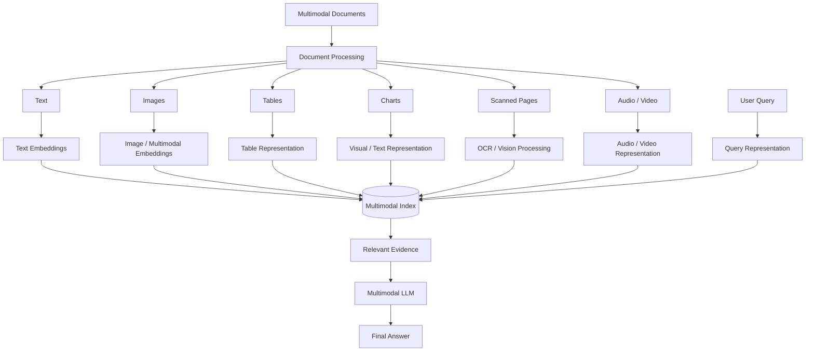
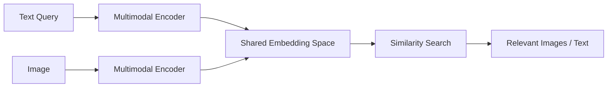
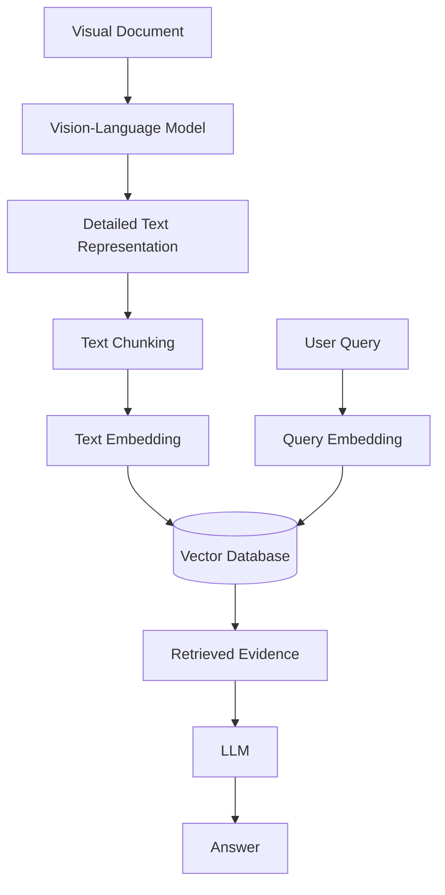
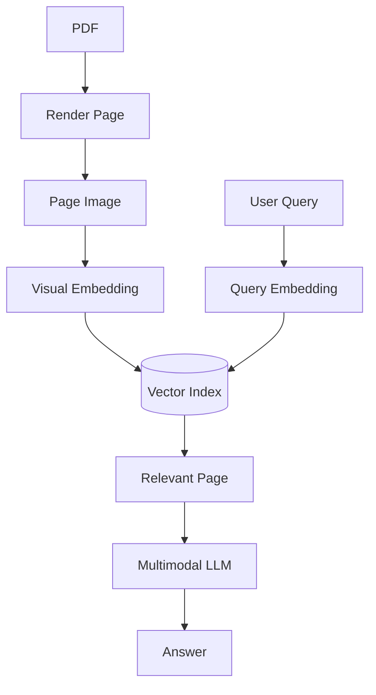
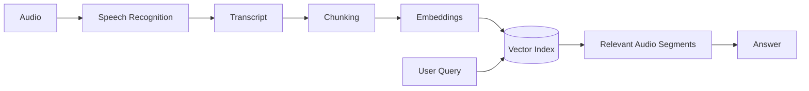
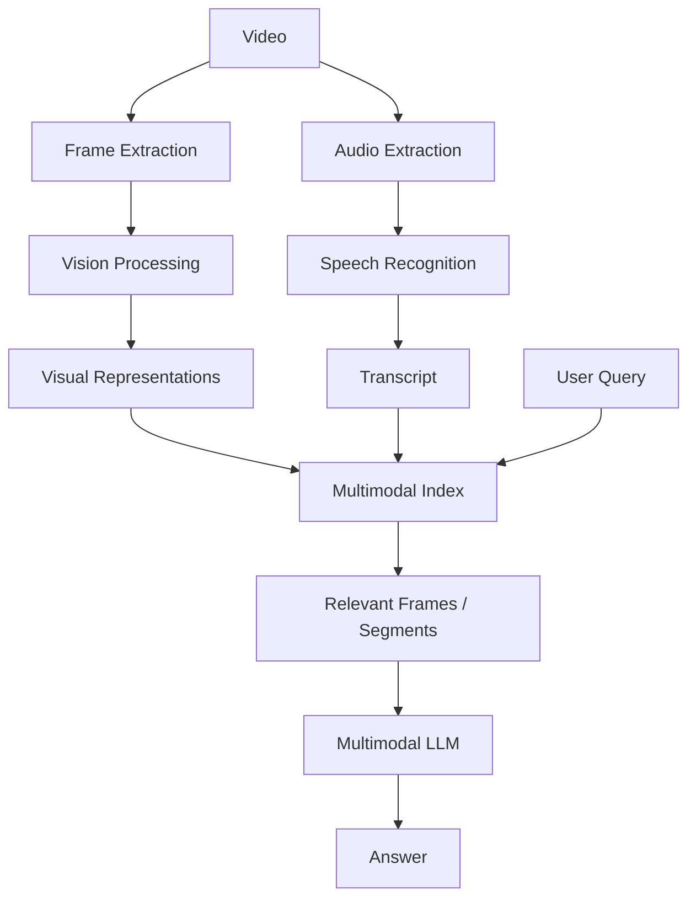
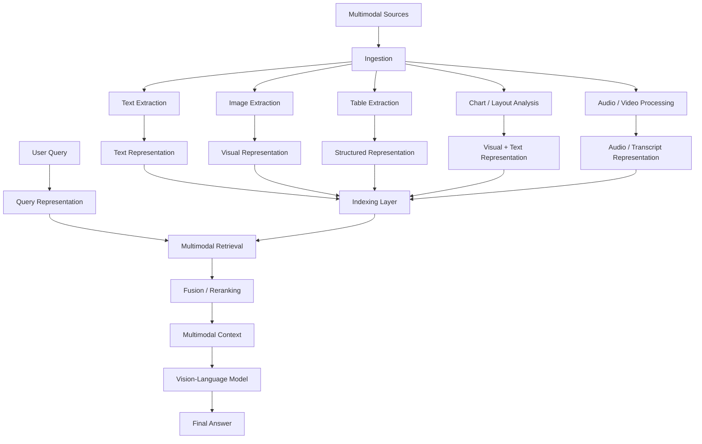
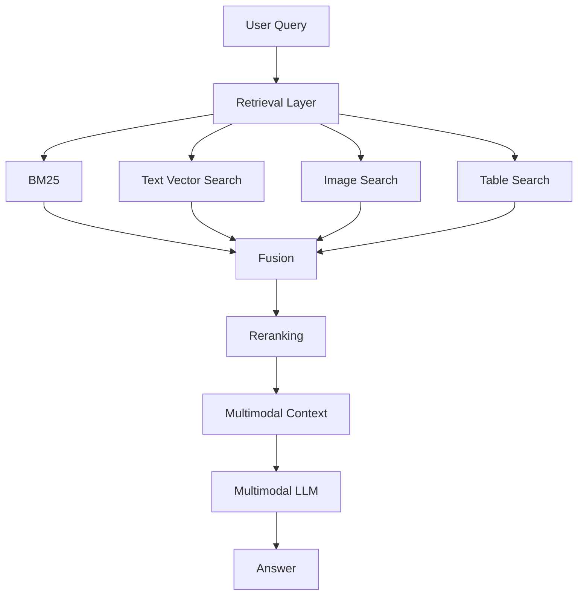

# 18 — Multimodal RAG

## 📌 Overview

**Multimodal RAG (Multimodal Retrieval-Augmented Generation)** extends RAG beyond plain text.

Traditional RAG primarily works with:

> **Text → Chunks → Embeddings → Retrieval → LLM**

Multimodal RAG allows the system to retrieve and reason over different types of information, including:

* Text
* Images
* Scanned PDFs
* Tables
* Charts
* Diagrams
* Screenshots
* Audio
* Video frames

The core idea is:

> **Retrieve the right information regardless of its modality, then provide that evidence to a multimodal model for generation.**

For example, consider a financial report containing:

* Paragraphs describing revenue
* A revenue table
* A line chart showing quarterly growth
* A scanned signature page

A text-only RAG system may lose important information contained in the visual elements.

Multimodal RAG attempts to preserve and retrieve that information.

---

# 🏗️ Multimodal RAG Architecture

A multimodal system can ingest multiple modalities and build appropriate indexes.



The important change is that the ingestion pipeline is no longer:

```text
Document → Text → Chunks
```

It becomes:

```text
Document
   ↓
Detect Modalities
   ↓
Extract / Represent Each Modality
   ↓
Index
   ↓
Retrieve
   ↓
Multimodal Generation
```

---

# 🧩 Multimodal Indexing Approaches

There are several ways to index multimodal information.

## 1️⃣ Multimodal Embeddings

Text and images can be represented in a **shared or aligned embedding space**, allowing a query in one modality to retrieve information represented in another modality.

Examples of multimodal embedding approaches include:

* CLIP-style models
* OpenCLIP
* Other vision-language embedding models

Conceptually:

```text id="q4y6aw"
Text Query
    ↓
Embedding
    ↓
Shared Embedding Space
    ↑
Image Embedding
```

For example:

> "red sports car"

could potentially retrieve an image of a red sports car even when the image contains no textual description.

### Architecture



### Main advantage

The system can perform **cross-modal retrieval**.

For example:

```text
Text → Image
Image → Text
Text → Text
Image → Image
```

depending on the capabilities of the embedding model.

---

# 2️⃣ Text Summarization of Visuals

Another strategy is to convert visual information into text before indexing.

A Vision-Language Model can inspect:

* Charts
* Tables
* Diagrams
* Screenshots
* Scanned pages

and produce detailed textual descriptions.

### Example

Original chart:

```text
Quarterly Revenue
Q1 → $2M
Q2 → $2.4M
Q3 → $3M
Q4 → $3.8M
```

A vision model might produce a representation such as:

```text
"The company's quarterly revenue increased from approximately
$2 million in Q1 to $3.8 million in Q4, showing a consistent
upward trend throughout the year."
```

That description can then be embedded using a standard text embedding model.

### Architecture



### Advantage

This approach allows existing text-RAG infrastructure to be reused.

### Limitation

The generated description may lose visual details.

For example:

* Exact chart geometry
* Spatial relationships
* Colors
* Layout
* Small labels
* Visual hierarchy

Therefore:

> **A textual summary is a representation of the visual, not the visual itself.**

---

# 3️⃣ Native Multimodal Retrieval

A more advanced approach is to preserve the original visual content and retrieve it directly.

For example:

```text id="b5d1br"
PDF Page
   ↓
Page Image
   ↓
Visual Embedding
   ↓
Vector Index
```

When the user asks a question, the system retrieves the relevant page image and passes the original image to a multimodal model.

This can preserve visual information that a text summary might lose.



---

# 📄 Multimodal RAG for PDFs

PDFs are particularly challenging because a PDF is not always just text.

A page may contain:

```text
┌───────────────────────────┐
│ Heading                   │
│                           │
│ Paragraph      Chart      │
│                           │
│ Table                    │
│                           │
│ Footer                    │
└───────────────────────────┘
```

A simple text extractor may produce:

```text
Heading
Paragraph
Chart labels
Table values
Footer
```

while losing the original spatial relationships.

Multimodal RAG can preserve the page as an image or use layout-aware processing.

---

# 🧭 Layout-Aware Retrieval

For documents where spatial structure matters, the system should understand:

* Where text appears
* Where tables appear
* Which labels belong to which chart
* Reading order
* Columns
* Headers
* Footnotes
* Captions

This is especially important for:

* Financial reports
* Research papers
* Invoices
* Technical manuals
* Legal documents
* Scientific papers

The retrieval unit can therefore be more than a text chunk.

```text id="5vmbk4"
Document
   ↓
Page
   ↓
Region
   ├── Text
   ├── Table
   ├── Chart
   └── Image
```

---

# 📊 Multimodal RAG for Tables

Tables are one of the biggest weaknesses of naive text extraction.

Consider:

| Year | Revenue | Growth |
| ---- | ------: | -----: |
| 2023 |    $10M |      — |
| 2024 |    $14M |    40% |
| 2025 |    $21M |    50% |

A poor extraction process may turn the table into a sequence of values without preserving row/column relationships.

A multimodal pipeline can preserve:

* Headers
* Rows
* Columns
* Cell relationships
* Merged cells
* Table structure

The system can then answer:

> "What was the revenue growth between 2024 and 2025?"

without losing the relationship between the values.

---

# 📈 Multimodal RAG for Charts

Charts contain information that may not exist explicitly in surrounding text.

For example:

```text
Revenue
  ↑
  │             ●
  │         ●
  │      ●
  │   ●
  └────────────────→ Time
```

A Vision-Language Model can interpret:

* Trends
* Relative changes
* Labels
* Legends
* Axes
* Data points
* Relationships

The resulting evidence can be used by the LLM to answer questions such as:

> "Which quarter had the highest revenue?"

or:

> "Did revenue increase consistently?"

---

# 🖼️ Image Retrieval

Multimodal RAG can also retrieve images directly.

Example:

> **User:** "Show me the architecture diagram for the authentication system."

The system can:

```text
Query
 ↓
Multimodal Retrieval
 ↓
Architecture Diagram
 ↓
Multimodal LLM
 ↓
Answer / Explanation
```

This is different from simply retrieving text describing the architecture.

---

# 🎧 Audio RAG

Multimodal RAG can also work with audio.

A common pipeline is:



For some applications, the system can also preserve links to the original audio timestamps.

Example:

> "When did the speaker discuss the pricing strategy?"

The system can retrieve:

```text
00:34:12 → 00:36:45
```

and use the corresponding transcript/audio evidence.

---

# 🎥 Video RAG

Video can be treated as a combination of:

* Audio
* Transcript
* Frames
* OCR
* Visual events

A conceptual pipeline:



This allows questions such as:

> "When did the presenter show the database architecture?"

---

# 🔎 Multimodal Retrieval

The retrieval layer may combine several retrieval strategies.

```text id="3a3t1q"
                ┌── Text Retrieval
                │
Query ──────────┼── Image Retrieval
                │
                ├── Table Retrieval
                │
                └── Audio / Video Retrieval
                         ↓
                     Fusion
                         ↓
                  Reranking
                         ↓
                Relevant Evidence
```

This is essentially **Hybrid Retrieval across modalities**.

---

# 🧠 Multimodal Context

The final LLM context might contain different evidence types:

```text id="l7n8hz"
Context:

[TEXT]
"The company reported strong revenue growth..."

[TABLE]
Revenue by Quarter:
Q1: $2M
Q2: $2.4M
Q3: $3M
Q4: $3.8M

[IMAGE]
Quarterly revenue chart

[PAGE]
Original PDF page
```

A multimodal model can reason over the combined evidence.

---

# 🏗️ Complete Multimodal RAG Pipeline



---

# 🔗 Multimodal RAG + Reranking

Reranking is especially useful when retrieval happens across multiple modalities.

For example:

```text id="q8t1fs"
Query
 ↓
Text Retrieval → 20 results
Image Retrieval → 20 results
Table Retrieval → 20 results
 ↓
Fusion
 ↓
60 candidates
 ↓
Multimodal Reranker
 ↓
Top 5 evidence items
 ↓
Multimodal LLM
```

The reranker can consider the relationship between the query and different evidence types.

---

# 🔗 Multimodal RAG + Hybrid RAG

Multimodal retrieval can also combine:

* Dense text search
* BM25
* Image embeddings
* Metadata filters
* Structured table retrieval

For example:



---

# 🧩 Multimodal Embeddings vs Visual-to-Text

These two approaches have different strengths.

| Approach                | Representation                          | Main Strength                    | Main Weakness                          |
| ----------------------- | --------------------------------------- | -------------------------------- | -------------------------------------- |
| Multimodal Embeddings   | Text + visual vectors                   | Cross-modal retrieval            | Requires suitable multimodal encoder   |
| Visual-to-Text          | Visual → textual description            | Reuses text-RAG infrastructure   | Can lose visual information            |
| Native Visual Retrieval | Original visual content                 | Preserves visual details         | More complex multimodal infrastructure |
| Structured Extraction   | Tables/data → structured representation | Excellent for exact data queries | Requires modality-specific processing  |

A production system may use **more than one approach**.

---

# 🎯 Example: Financial Report RAG

Imagine a 200-page annual report.

It contains:

* Text
* Financial tables
* Revenue charts
* Company logos
* Scanned pages

A user asks:

> **"How did revenue change between Q1 and Q4, and what does the chart show?"**

A text-only RAG system might retrieve:

```text
Revenue increased significantly during the year.
```

A multimodal system could retrieve:

```text
Text:
"Revenue increased throughout the year."

Table:
Q1 → $2M
Q4 → $3.8M

Chart:
Upward revenue trend
```

The multimodal model can combine these sources to produce a more complete answer.

---

# ⚠️ Common Failure Modes

## 1. Loss of Visual Information

Converting every image into text can lose:

* Spatial relationships
* Exact positioning
* Visual hierarchy
* Fine-grained details

---

## 2. OCR Errors

Scanned documents may contain:

* Incorrect characters
* Missing text
* Wrong numbers
* Broken table structures

This is especially dangerous for financial and legal documents.

---

## 3. Chart Misinterpretation

Vision models can sometimes misunderstand:

* Axis scales
* Legends
* Small labels
* Overlapping data
* Exact numerical values

For exact numerical questions, structured extraction or source-data validation can be preferable.

---

## 4. Retrieval Granularity

Choosing the wrong retrieval unit can hurt performance.

Possible units include:

```text
Document
 ↓
Page
 ↓
Region
 ↓
Image
 ↓
Table
 ↓
Cell
```

The correct granularity depends on the application.

---

## 5. Context Explosion

Images can consume substantial multimodal context.

Retrieving ten full PDF pages when two are sufficient can increase:

* Latency
* Token usage
* Processing cost
* Model confusion

Therefore:

> **Retrieve only the visual evidence necessary for the question.**

---

# 🔐 Multimodal Security Considerations

Multimodal RAG introduces additional risks.

For example, an image can contain:

* Sensitive information
* Hidden instructions
* Personal information
* Malicious prompt-injection content

A screenshot might contain text such as:

> "Ignore previous instructions..."

The system should treat content inside retrieved documents/images as **untrusted data**, not as system instructions.

Authorization and data-access controls should also apply to images, pages, tables, and other modalities—not only text chunks.

---

# 🧠 Multimodal RAG vs Traditional RAG

| Capability            |  Traditional RAG | Multimodal RAG |
| --------------------- | ---------------: | -------------: |
| Text                  |                ✅ |              ✅ |
| Images                |          Limited |              ✅ |
| Tables                |          Limited |              ✅ |
| Charts                |          Limited |              ✅ |
| Scanned PDFs          |          Limited |              ✅ |
| Audio                 | Usually separate |              ✅ |
| Video                 | Usually separate |              ✅ |
| Layout understanding  |          Limited |              ✅ |
| Cross-modal retrieval |                ❌ |              ✅ |
| Multimodal generation |                ❌ |              ✅ |

---

# ⚖️ Tradeoffs

### ✅ Advantages

* Handles real-world documents
* Preserves visual information
* Supports images and diagrams
* Better for tables and charts
* Can process scanned documents
* Enables cross-modal retrieval
* Supports richer document understanding
* Useful for audio/video knowledge bases

### ❌ Disadvantages

* More complex ingestion pipeline
* More expensive processing
* More storage requirements
* More difficult evaluation
* OCR can introduce errors
* Vision models can misinterpret visuals
* Multimodal context can become expensive
* Requires modality-specific retrieval strategies

---

# 🧠 Key Mental Model

Traditional RAG:

```text id="5nq3kf"
Text
 ↓
Chunks
 ↓
Embeddings
 ↓
Retrieval
 ↓
LLM
```

Multimodal RAG:

```text id="9x2v8m"
Text ────────┐
Images ──────┤
Tables ──────┤
Charts ──────┼──→ Multimodal Index
PDF Layout ──┤
Audio ───────┤
Video ───────┘
                  ↓
               Retrieval
                  ↓
          Multimodal Evidence
                  ↓
          Vision-Language Model
                  ↓
              Answer
```

The most important idea is:

> **Don't reduce every document to plain text if the visual structure itself contains useful information.**

---

# 📌 Key Takeaway

**Multimodal RAG = RAG across multiple information modalities.**

The two foundational strategies are:

### **1. Multimodal Embeddings**

```text
Text + Image
      ↓
Shared / Aligned Embedding Space
      ↓
Cross-Modal Retrieval
```

### **2. Visual-to-Text Representation**

```text
Image / Chart / Table
        ↓
Vision-Language Model
        ↓
Detailed Text Representation
        ↓
Text Embeddings
        ↓
Standard RAG
```

More advanced systems can preserve and retrieve the **original visual evidence** rather than relying only on generated descriptions.

The core mental model is:

> **Traditional RAG retrieves text. Multimodal RAG retrieves information regardless of whether that information lives in text, images, tables, charts, pages, audio, or video.**

This makes Multimodal RAG especially useful for **financial reports, research papers, technical manuals, invoices, scanned documents, dashboards, educational content, meeting recordings, and visual knowledge bases**.
