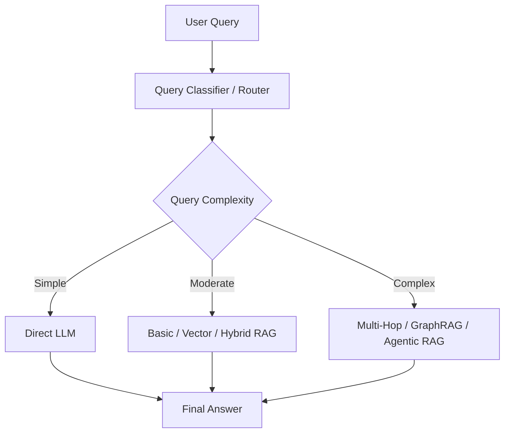
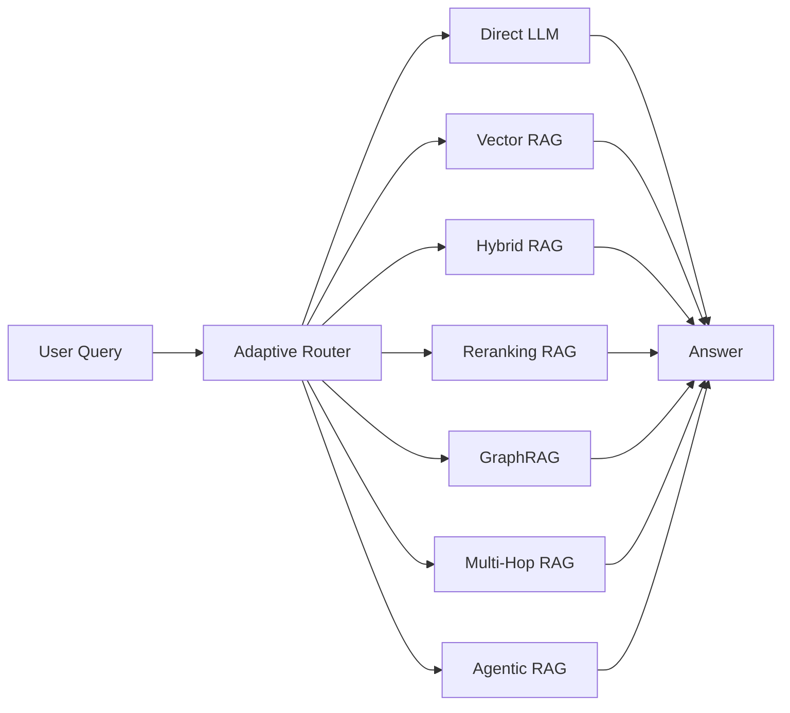
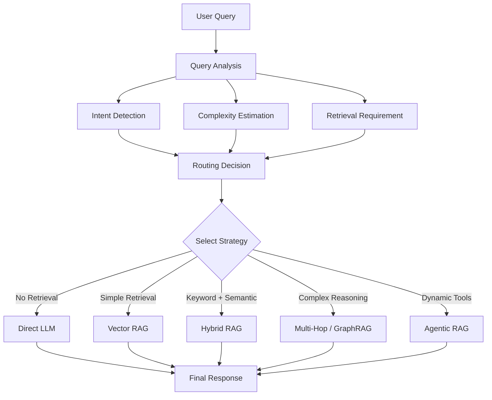
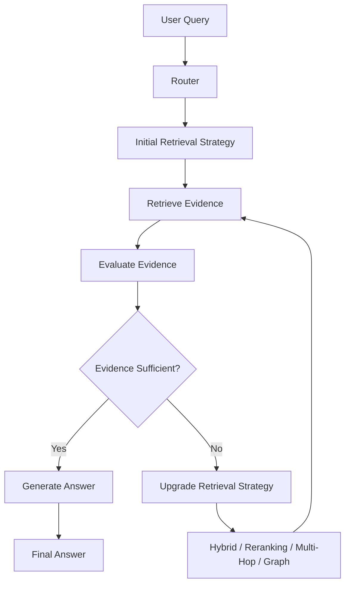
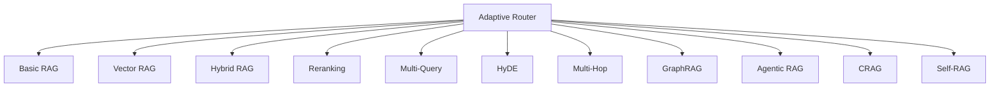
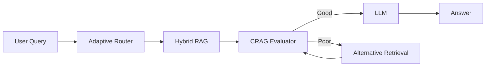
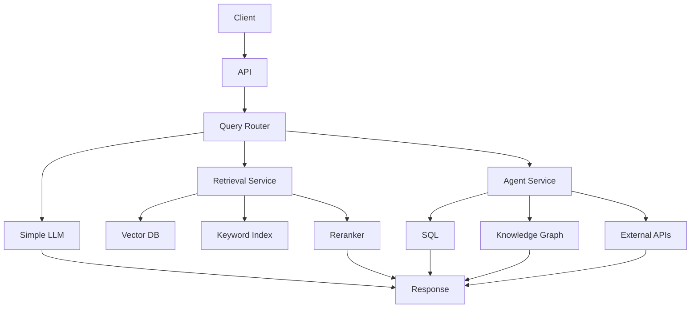

# 19 — Adaptive RAG

## 📌 Overview

**Adaptive RAG** dynamically chooses the most appropriate retrieval strategy based on the **complexity, intent, or characteristics of the incoming query**.

Instead of sending every question through the same expensive RAG pipeline, Adaptive RAG introduces a **query router / classifier** that decides how much retrieval and reasoning is actually required.

For example:

* **Simple factual query** → answer directly with the LLM.
* **Moderate knowledge query** → use Basic, Vector, or Hybrid RAG.
* **Complex multi-hop query** → use Multi-Hop, GraphRAG, or Agentic RAG.

The main goal is to balance:

> **Answer Quality + Latency + Cost**

---

## 🏗️ Query Routing Pipeline



The router acts as the **decision layer** before retrieval.

---

## 🎯 Why Adaptive RAG?

A traditional RAG system often follows a fixed pipeline:

```text
Every Query
    ↓
Embedding
    ↓
Vector Search
    ↓
Reranking
    ↓
LLM
```

But not every question requires this much processing.

Consider:

> "What is 2 + 2?"

Running vector search, reranking, and multiple retrieval loops would add unnecessary latency and cost.

Now consider:

> "How did the company's acquisition of Startup A affect its patent portfolio through its subsidiaries?"

This may require:

* Multiple documents
* Entity relationships
* Sequential retrieval
* Graph traversal
* Multiple reasoning steps

Adaptive RAG recognizes this difference and selects an appropriate strategy.

---

## 🧠 Query Complexity Classification

A router can classify queries using several signals.

### 1. Simple Queries

Questions that can usually be answered without external retrieval.

**Examples:**

```text
What is Python?
What does HTTP stand for?
What is 10 × 10?
```

Possible route:

```text
User Query
    ↓
Classifier
    ↓
Direct LLM
```

---

### 2. Moderate Queries

Questions that require information from a knowledge base but don't require extensive reasoning.

**Examples:**

```text
What is our company's leave policy?
What features are available in Product X?
What is the refund policy?
```

Possible route:

```text
User Query
    ↓
Classifier
    ↓
Hybrid RAG
    ↓
Reranking
    ↓
LLM
```

---

### 3. Complex Queries

Questions requiring multiple pieces of evidence or sequential reasoning.

**Examples:**

```text
Which companies acquired startups that later
filed patents related to artificial intelligence?
```

Possible route:

```text
User Query
    ↓
Classifier
    ↓
Agentic / GraphRAG
    ↓
Multi-Hop Retrieval
    ↓
Evidence Aggregation
    ↓
LLM
```

---

# 🔀 Adaptive Routing Strategies

The router does not necessarily have to choose only between **RAG** and **No RAG**.

It can select from many retrieval strategies.



This turns the RAG system into a **routing architecture** rather than one fixed pipeline.

---

# 🧩 What Can the Router Consider?

The router can use different features to make its decision.

### Query Complexity

```text
Simple → Moderate → Complex
```

### Query Intent

```text
Definition
Information lookup
Comparison
Analysis
Troubleshooting
Multi-step reasoning
```

### Required Data Source

```text
Vector DB
SQL Database
Knowledge Graph
Web Search
API
Multiple Sources
```

### Confidence

The router can estimate whether the LLM can answer reliably without retrieval.

### Retrieval Requirement

Some queries explicitly require company-specific or private information.

For example:

```text
"What is our company's Q3 revenue?"
```

Even if the query is linguistically simple, it still requires retrieval because the information is external to the model's general knowledge.

So:

> **Query complexity is not the same thing as retrieval necessity.**

---

# 🏗️ Router Architecture

A more realistic Adaptive RAG architecture can look like this:



---

# ⚡ Adaptive RAG vs Fixed RAG

### Fixed RAG

```text
Every Query
      ↓
Same Retrieval Pipeline
      ↓
Same Generation Pipeline
```

### Adaptive RAG

```text
Every Query
      ↓
Analyze Query
      ↓
Choose Strategy
      ↓
Execute Appropriate Pipeline
```

The second approach can avoid unnecessary retrieval for easy questions while allocating more computation to difficult questions.

---

# 🔎 Example

Suppose a company has thousands of documents.

### Query 1

> "What is our office address?"

Router:

```text
Complexity: Simple
Retrieval: Required
Strategy: Metadata / Simple Retrieval
```

---

### Query 2

> "What is the company's remote-work policy?"

Router:

```text
Complexity: Moderate
Retrieval: Required
Strategy: Hybrid RAG
```

---

### Query 3

> "Compare the remote-work policies introduced in 2023 and 2025 and explain how the changes affected employees in different departments."

Router:

```text
Complexity: Complex
Retrieval: Required
Strategy: Multi-Hop + Reranking
```

---

### Query 4

> "Find all acquisitions made by Company A and identify which acquired companies subsequently received AI-related patents."

Router:

```text
Complexity: Complex
Retrieval: Required
Strategy: GraphRAG / Agentic RAG
```

---

# 🧠 Adaptive RAG with Confidence

Routing does not have to happen only once.

The system can adapt after retrieval as well.



For example:

```text
Vector RAG
   ↓
Poor evidence
   ↓
Hybrid RAG
   ↓
Still insufficient
   ↓
Multi-Hop / GraphRAG
   ↓
Generate Answer
```

This creates a **progressive retrieval strategy**.

---

# 🔄 Adaptive RAG + Previous RAG Patterns

Adaptive RAG is especially powerful because it can act as an **orchestration layer** over the techniques learned in previous labs.



This is an important architectural idea:

> **Adaptive RAG doesn't replace individual RAG techniques. It decides when and how to use them.**

---

# 🆚 Adaptive RAG vs Agentic RAG

These concepts are related but different.

| Adaptive RAG                             | Agentic RAG                            |
| ---------------------------------------- | -------------------------------------- |
| Focuses on routing                       | Focuses on autonomous decision-making  |
| Usually starts with query classification | Can continuously decide what to do     |
| Often selects a predefined pipeline      | Can dynamically select and chain tools |
| More predictable                         | More flexible                          |
| Easier to control                        | More complex                           |
| Good for cost/latency optimization       | Good for complex workflows             |

They can also be combined:

```text
Adaptive Router
      ↓
Agentic RAG
      ↓
Dynamic Tool Execution
```

---

# 🆚 Adaptive RAG vs CRAG

**CRAG** primarily asks:

> "Are my retrieved documents good enough?"

**Adaptive RAG** primarily asks:

> "Which retrieval strategy should I use?"

They can work together:



---

# 🏭 Production Architecture

A production Adaptive RAG system may contain:



The router can also log:

```text
query
selected_route
retrieval_strategy
latency
token_usage
retrieval_quality
answer_quality
fallback_count
```

These metrics can later be used to improve routing decisions.

---

# 📊 Router Evaluation

A router itself needs evaluation.

Important metrics include:

### Routing Accuracy

Did the router select an appropriate strategy?

### Answer Quality

Did the selected strategy produce a correct answer?

### Latency

How long did the complete request take?

### Cost

How many tokens / model calls / retrieval operations were required?

### Over-Routing

Did the router unnecessarily select expensive pipelines?

```text
Easy Query
   ↓
Agentic RAG
   ↓
High Cost
```

### Under-Routing

Did the router choose a pipeline that was too weak?

```text
Complex Query
   ↓
Direct LLM
   ↓
Poor Answer
```

A good Adaptive RAG system balances both.

---

# ⚠️ Common Failure Modes

### 1. Incorrect Classification

The router may underestimate query complexity.

### 2. Over-Routing

Everything gets sent to expensive Agentic/GraphRAG pipelines.

### 3. Under-Routing

Complex questions are sent through simple retrieval.

### 4. Router Latency

A sophisticated classifier can itself introduce noticeable latency.

### 5. Cascading Errors

A bad routing decision can prevent the correct retrieval strategy from ever running.

### 6. Static Routing Rules

Hard-coded rules may work initially but become difficult to maintain as the application grows.

---

# ⚖️ Tradeoffs

| Advantage                        | Disadvantage                         |
| -------------------------------- | ------------------------------------ |
| Lower average latency            | Additional routing step              |
| Lower cost                       | Router can make mistakes             |
| Better resource utilization      | More system complexity               |
| Supports multiple RAG strategies | Requires evaluation                  |
| Can adapt to query difficulty    | Routing logic needs maintenance      |
| Can combine many architectures   | Poor routing can hurt answer quality |

---

# 🧠 Key Mental Model

Traditional RAG:

```text
Query
  ↓
Retrieve
  ↓
Generate
```

Adaptive RAG:

```text
Query
  ↓
Analyze
  ↓
Choose Strategy
  ↓
Retrieve / Reason
  ↓
Evaluate
  ↓
Generate
```

The most important idea is:

> **Don't use the most expensive RAG pipeline for every question. Use the simplest strategy that can reliably answer the query.**

---

# 📌 Key Takeaway

**Adaptive RAG = Intelligent Retrieval Routing**

It introduces a decision layer that dynamically determines **whether retrieval is needed and which retrieval/reasoning strategy should be used**.

A mature RAG system can therefore evolve from:

```text
One RAG Pipeline
```

into:

```text
                    ┌── Direct LLM
                    ├── Vector RAG
User Query → Router ├── Hybrid RAG
                    ├── Reranking
                    ├── Multi-Hop
                    ├── GraphRAG
                    └── Agentic RAG
```

This makes Adaptive RAG an important bridge between **traditional RAG pipelines** and **intelligent, production-grade retrieval systems**.
